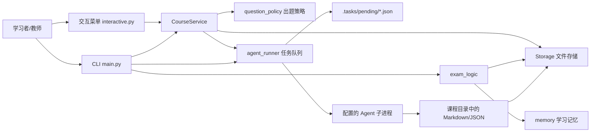
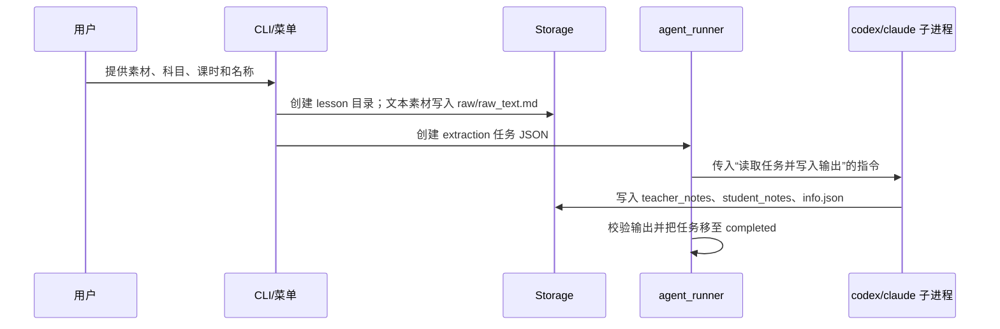
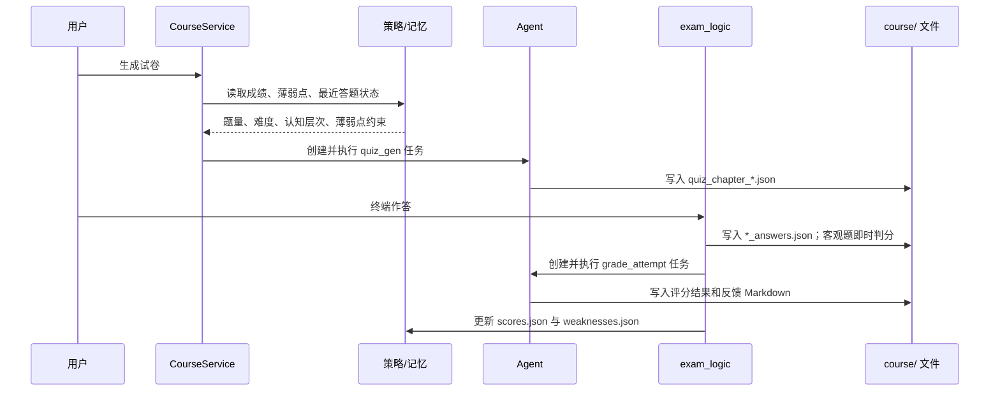

# AI 学习助教：功能与架构文档

> 基于当前代码库 `v0.2.0` 的静态分析整理。本文描述的是已实现的运行行为，而不是仅来自 README 的目标设想。

## 1. 产品定位与边界

AI 学习助教是一个 **本地优先、终端交互式** 的学习闭环工具。它将视频链接、本地文件或文本素材转化为教师教纲和学生笔记，再提供试卷生成、终端答题、AI 批阅、错题复习、成绩追踪和总结评估。

系统没有 Web 服务、数据库、用户登录、浏览器前端或后台常驻 Worker。课程、试卷、作答记录、任务和学习记忆均以项目目录中的 Markdown/JSON 文件保存；AI 相关工作主要由本机配置的 Agent 命令执行。

## 2. 已实现功能

| 功能域 | 能力 | 主要入口/模块 |
| --- | --- | --- |
| 课程管理 | 新建、列出、删除科目；列出、删除课时 | `main.py`、`src/interactive.py`、`src/storage.py` |
| 素材导入 | URL（B站/YouTube）、本地音视频/文档、直接文本 | `--load-url`、`--load-video`、`--load-doc`、`--source-text` |
| 知识加工 | 生成教师教纲、学生笔记、课时元数据；支持从原始素材重生成 | `src/agent_runner.py`、`--fix-doc` |
| 学习阅读 | 终端查看师生笔记和原始文本；导出合并 Markdown | `--learn`、`--export-md` |
| 测验生成 | 基于课时内容、掌握度、错题和题目策略生成结构化试卷 | `--exam-new`、`src/course_service.py`、`src/question_policy.py` |
| 测验执行 | 选择历史试卷、终端答题、客观题即时判分 | `--exam`、`src/exam_logic.py` |
| 主观题批阅 | Agent 根据教纲、笔记、题目与答案生成评分、反馈和复习建议 | `grade_attempt_with_claude_cli` |
| 错题闭环 | 聚合错题、生成错因解析、维护知识薄弱点、支持复习考试 | `--wrong-list`、`--fix-wrong`、`src/memory.py` |
| 学习评估 | 输入学习总结，输出基于课程内容的评估 JSON | `--summarize` |
| 任务恢复 | 查询、批量处理、重试已落盘的待处理任务 | `--process-tasks`、`process_tasks.py` |

### 题目策略

`src/question_policy.py` 将学习状态映射为出题要求：

- 内容复杂度对应基础题量：简单 5、普通 8、复杂 12；连续错误至少 2 题时加 3 题，最终限制在 5 到 15 题。
- 掌握度达到 85% 且最近连续答对至少 3 题时，策略返回 0，表达“可以停止继续练习”。
- 认知层次按掌握度切换：低掌握度偏回忆/理解，中等掌握度偏应用，高掌握度偏迁移/反思。
- 默认难度比例为简单 20%、中等 50%、困难 20%、挑战 10%，并要求薄弱知识点优先覆盖。

## 3. 总体架构



### 分层职责

| 层次 | 模块 | 职责 |
| --- | --- | --- |
| 表现层 | `main.py`、`src/interactive.py`、`tutor.sh` | 参数解析、命令调度、终端菜单、输入输出与确认交互 |
| 应用服务层 | `src/course_service.py` | 科目/课时用例封装；汇总笔记、记忆和策略上下文后创建任务 |
| 领域逻辑层 | `src/exam_logic.py`、`src/memory.py`、`src/question_policy.py`、`src/models.py` | 试卷与作答模型、客观题判分、错题与掌握度、组卷、策略计算 |
| 基础设施层 | `src/storage.py`、`src/config_loader.py`、`src/agent_runner.py` | 文件读写、配置和环境变量、任务持久化、Agent 子进程调用、输出校验 |
| AI/素材适配层 | `src/ai_adapter/`、`src/material_parse/`、`src/container_runner.py` | OpenAI 兼容 API、PDF/Word/音视频/字幕解析、Docker 执行环境；目前多为备用或旧路径 |

## 4. 关键运行流程

### 4.1 导入并生成课程资料



URL 与本地文件的解析说明会写入任务提示词，实际下载字幕、读取文档或提取音频的动作由 Agent 完成。直接文本会先保存为 `raw/raw_text.md`，作为可追溯的原始材料。

### 4.2 出题、答题与学习记忆



客观题（单选、多选、判断）由本地逻辑判分；简答和案例分析由 Agent 批阅。答题记录始终先持久化，即使 AI 批阅失败，也会标记为待处理，可通过 `--grade-pending` 重试。

## 5. 持久化与数据模型

默认根目录由 `config.json.default_course_path` 决定（默认 `./course`），可由 `TUTOR_COURSE_PATH` 覆盖。

```text
course/
├── weaknesses.json                 # 跨课程/课时的薄弱点
├── scores.json                     # 所有考试成绩
└── {slugified-subject}/
    ├── .subject                    # 空科目标记
    └── lesson_01/
        ├── info.json               # subject、lesson、name、来源等
        ├── raw/raw_text.md         # 直接输入或已提取的原始文本
        ├── teacher_notes/content.md
        ├── student_notes/content.md
        ├── exam/
        │   ├── quiz_chapter_*.json
        │   ├── quiz_chapter_*_student.md
        │   ├── quiz_chapter_*_teacher.md
        │   ├── *_answers.json
        │   ├── *_grade_result.json
        │   └── *_feedback.md
        ├── wrong_questions/        # 预留的错题目录
        ├── summary_result.json
        └── export.md

.tasks/
├── pending/{task_id}.json
└── completed/{task_id}.json        # 成功和失败都归档于此，靠 status 区分
```

核心 Pydantic 模型位于 `src/models.py`：

- `LessonInfo`：课时元信息。
- `Quiz` / `QuizQuestion`：试卷、题型、难度、认知层级和考查知识点。
- `Answer` / `Attempt` / `QuestionFeedback`：答案、作答记录、单题反馈。
- `Weakness`：知识点的严重程度、证据、复习次数和已掌握状态。

科目目录会经 `slugify` 转换为小写、空格转连字符的名称。因此命令行显示的科目名和磁盘目录名可能不完全相同。

## 6. AI 任务架构

### 当前主路径

`config.json.agent_command` 默认是：

```text
codex exec --sandbox workspace-write --ask-for-approval never
```

也可设为 `claude` 预设或任意可执行命令。`agent_runner.py` 将每项工作序列化为 `.tasks/pending` 下的 JSON，随后以子进程启动该命令，并要求 Agent 读取任务文件、根据 `prompt` 执行、将结果写到指定输出目录。任务类型包括：

- `extraction`、`regenerate`：生成或重生成笔记。
- `quiz_gen`、`exam_review`：生成试卷。
- `grade_attempt`：批阅作答记录，回写分数、反馈和薄弱点。
- `fix_wrong`：生成错题解析。
- `summarize`：评估学生总结。

生成后的 JSON 会做最佳努力的格式修复和解析校验；任务完成态由文件是否生成来判断，再从 `pending` 移到 `completed`。

### 兼容/备用路径

以下模块实现了能力，但不是当前 CLI 默认路径的核心依赖：

| 模块 | 原用途 | 当前状态 |
| --- | --- | --- |
| `src/ai_adapter/` | 调用 OpenAI 兼容 Chat Completions API | 仍可被内部直连处理函数使用，但主流程优先 Agent 子进程 |
| `src/material_parse/` | 本地 PDF/Word/字幕/音视频、URL 字幕文本解析 | 代码存在，但当前导入主流程将解析责任交给 Agent |
| `src/container_runner.py` 与 `Dockerfile` | Docker 内安装 Claude CLI、yt-dlp、ffmpeg | 未由主入口调用，属于隔离执行的备用实现 |
| `src/course_build.py`、`src/summary_check.py` | 基于直连 AI 生成笔记/评估总结 | 未被当前命令处理器直接调用 |
| `src/extraction_runner.py` | 旧提取入口 | 主要作为 `agent_runner` 的兼容转发层 |

## 7. 配置与运行依赖

- Python：`>=3.11`；依赖由 `pyproject.toml`/`uv.lock` 管理。
- AI：需配置 `config.json` 中的 `agent_command`；直连 API 备用路径还需要 `ai_config.providers` 的 Key、Base URL 和模型。
- 环境变量优先级高于配置：`OPENAI_API_KEY`、`OPENAI_BASE_URL`、`OPENAI_MODEL`、`TUTOR_COURSE_PATH`，以及 `TUTOR_CONFIG`。
- 媒体能力：URL/音视频场景依赖执行 Agent 可使用 `yt-dlp`、`ffmpeg`、网络与相应站点凭证；本地解析备用路径还依赖 `pypdf`、`python-docx`、`SpeechRecognition`、`pydub`。

## 8. 当前架构风险与建议

### P0/P1：应优先处理

1. **Agent 写权限与失败边界不够明确。** 默认命令是 `workspace-write`，但 Agent 任务可能处理任意用户提供的本地路径、下载外部内容并写入课程目录。建议把任务执行目录、允许读写路径、网络能力和命令白名单收敛到明确的运行配置，并在任务 JSON 中记录素材来源、执行版本和错误日志。
2. **任务完成判定偏弱。** `process_all_pending_via_claude` 只要发现任意声明输出文件即认为成功，未统一校验 `info.json`、笔记内容、试卷模型和总结/批阅 JSON 的完整性。建议按任务类型定义 Pydantic 校验器和原子写入策略，失败任务保留明确的 `failed` 队列与重试次数。
3. **“错题复习”入口没有真正传递复习语义。** `cmd_exam_review` 调用的是常规 `queue_exam_generation`，未设置 `retest=True`，所以任务类型、提示词和输出来源都可能仍是普通 `quiz_gen`。应新增明确的服务方法或参数，传入复习模式及跨课时错题范围。
4. **题目策略在低题量时存在互相矛盾。** 策略提示词要求至少 50% 主动推理和至少 20% 迁移，但低掌握度的认知配比不含迁移题；应使硬约束与分层配比一致，或对不同掌握度定义例外规则。

### P2：建议纳入后续治理

5. **存在两套 AI 与素材处理架构。** Agent 任务路径与 OpenAI 兼容 API、Docker、素材解析模块并存，注释中仍大量使用“Claude Code”命名，容易造成维护和测试漂移。建议确定一条正式生产路径，将另一条标为实验/移除，或以统一的 `AIExecutor` 接口隔离。
6. **职责存在重复。** `main.py`、`interactive.py` 和 `course_service.py` 都会创建/处理任务；`exam_logic.py` 同时承担领域规则、文件读写和 Agent 编排。建议让 CLI/TUI 仅做交互，让服务层拥有用例，让基础设施层执行任务与持久化。
7. **文件存储缺少并发控制和可迁移性。** 多进程同时答题或处理任务可能竞争 `scores.json`、`weaknesses.json` 和任务文件。建议短期增加文件锁与临时文件后原子替换；中长期考虑 SQLite，并保留 JSON/Markdown 导出。
8. **测试覆盖集中在纯逻辑。** 已有测试覆盖题目策略、存储和部分终端交互，但缺少 Agent 任务成功/失败状态迁移、任务输出校验、复习考试语义、总结评估和端到端最小闭环测试。
9. **源码中存在重复的 `_process_single_task` 定义。** 后定义会覆盖前定义，直连 API 处理逻辑的实际行为不直观；应删除死代码或拆分为不同执行器。

## 9. 推荐的演进目标

保持 CLI 和本地优先体验的前提下，可将目标形态收敛为：

```text
CLI/TUI
  -> Application Services（导入、练习、批阅、复习）
  -> Domain（课程、试卷、掌握度、错题）
  -> Ports（CourseRepository、TaskExecutor、AIProvider、MaterialParser）
  -> Adapters（Filesystem/SQLite、Codex/Claude/API、yt-dlp/ffmpeg）
```

这样能让 Agent、直连 API 和 Docker 解析成为可替换适配器，而课程生命周期、考试规则和学习记忆不再与某个 CLI 或模型供应商绑定。
