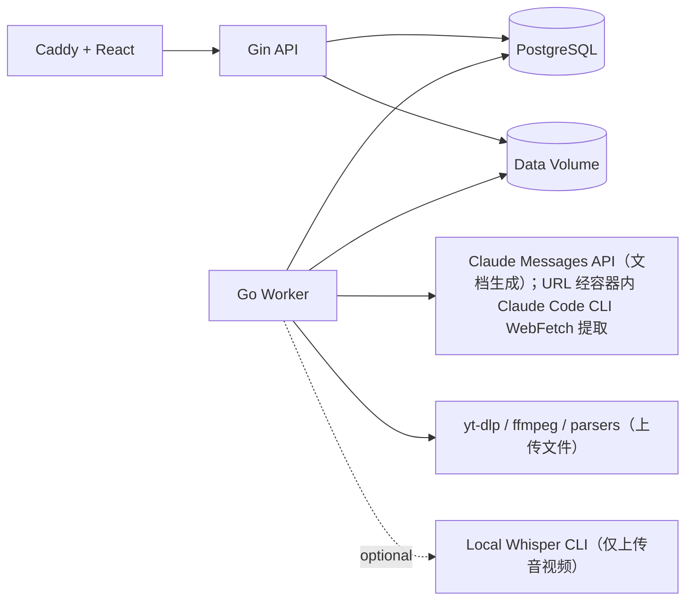

# Go 后端与 Worker 架构文档

## 1. 架构目标

后端采用模块化单体：一个 Go Module、共享领域代码、两个长期运行进程。

- `api`：Gin HTTP Server，负责 REST、SSE、上传、查询、事务和短时业务逻辑。
- `worker`：领取 PostgreSQL 任务，执行素材解析、Claude 调用、结果校验和发布。

该方案在单用户个人电脑上保持简单，同时解决当前 Python 系统的主要问题：文件并发写入、任务完成判定偏弱、AI 调用阻塞入口、失败状态不完整，以及业务逻辑分散在 CLI/TUI 中。

## 2. 运行时组件



### 2.1 API 进程职责

- 请求解析和 `go-playground/validator` 校验。
- 业务用例调用和 PostgreSQL 事务。
- 文件上传到临时区，并创建文件对象记录。
- 创建、取消和重试后台任务。
- 读取课程、内容、试卷、作答和进度。
- 客观题确定性判分。
- SSE 连接、事件回放和心跳。
- `/healthz`、`/readyz`、系统状态和指标。

API 禁止直接执行：

- `yt-dlp`、`ffmpeg` 和语音转写（仅服务上传媒体；URL 素材由 Worker 容器内 Claude Code CLI WebFetch 提取）。
- Claude API 请求。
- 长文切片和大文件解析。
- 大规模导出或备份。

### 2.2 Worker 进程职责

- 使用任务租约领取一个 Job。
- 定期续租并写入任务阶段/进度事件。
- 下载、解析、清洗和切片素材。
- 组装版本化 Prompt 和策略快照。
- 调用 Claude Messages API。
- 使用 Structured Outputs 获取题目、批阅和总结等 JSON。
- 校验 Schema、业务约束和跨实体引用。
- 将结果写入临时记录/文件，校验后原子发布。
- 处理取消、限流、超时、重试和不可重试错误。

Worker 默认并发为 1。代码允许配置并发，但增加并发前必须验证个人电脑资源、Anthropic Rate Limit 和任务幂等性。

## 3. 代码组织

按业务能力组织代码，不使用一个巨型 `service` 或 `handler` 包：

```text
backend/cmd/
├── api/main.go
├── worker/main.go
├── migrate/main.go
└── legacy-import/main.go

backend/internal/
├── course/
│   ├── entity.go
│   ├── repository.go
│   ├── service.go
│   ├── handler.go
│   └── service_test.go
├── lesson/
├── material/
├── document/
├── quiz/
├── attempt/
├── mastery/
├── summary/
├── job/
│   ├── entity.go
│   ├── repository.go
│   ├── dispatcher.go
│   ├── worker.go
│   └── events.go
├── ai/
│   ├── client.go
│   ├── anthropic.go
│   ├── prompts/
│   ├── schemas/
│   └── validation.go
├── filestore/
├── parser/
├── httpx/
└── platform/
    ├── config/
    ├── database/
    ├── logging/
    └── telemetry/
```

每个模块的公共边界应回答：

- 模块拥有什么数据和规则？
- 其他模块通过什么接口调用？
- 哪些副作用必须在事务中完成？
- 哪些操作会创建后台 Job？

Handler 只进行协议转换，不直接写 SQL。Repository 不包含跨模块业务决策。Worker Handler 只编排一个明确的 Job 类型。

## 4. 技术选型

| 能力 | 建议 |
| --- | --- |
| HTTP | Gin |
| 请求校验 | Gin binding + `go-playground/validator/v10` |
| PostgreSQL Driver | `pgx/v5` |
| SQL 代码生成 | `sqlc` |
| 数据库迁移 | `goose` 或等价显式迁移工具 |
| ID | UUID v4，由服务端生成 |
| 日志 | 标准库 `log/slog` JSON Handler |
| 配置 | 环境变量 + `_FILE` secret 约定，启动时一次性校验 |
| API 契约 | OpenAPI 3.1，服务端和前端类型由契约生成/校验 |
| AI SDK | Anthropic 官方 Go SDK |
| Schema | JSON Schema + Go 业务校验 |
| 测试 | `testing`、`testify`（可选）、Testcontainers、httptest |

Gin 官方文档支持路由分组、中间件、JSON 绑定与校验；安全相关中间件仍需本项目明确配置，不能依赖默认值。

## 5. 数据所有权

### 5.1 PostgreSQL 是唯一事实来源

下列内容以 PostgreSQL 为准：

- 课程和课时元数据。
- Markdown 原始文本、学生笔记、教师教纲及版本。
- 试卷、题库、作答、分数和反馈。
- 薄弱点、掌握状态和评估结果。
- 后台任务、事件、重试、AI 调用元数据。
- 文件对象元数据和存储引用。

### 5.2 文件卷

下列内容保存在 `APP_DATA_DIR`：

- 用户上传的原始大文件。
- 上传媒体的字幕和音频转写中间产物（URL 素材不再本地下载）。
- 导出的 Markdown/ZIP。
- 备份临时文件。
- 可选的本地 Whisper 模型（仅用于上传音视频转写）。

数据库保存 `storage_key`，禁止保存依赖宿主机绝对路径的业务引用。

### 5.3 文件发布规则

1. 上传或生成内容先进入同一数据卷的 `tmp/{job_id}/`，确保后续可原子重命名。
2. 计算 SHA-256、MIME 和大小，完成安全/格式校验。
3. 在短事务中插入 `file_objects(state=temporary)` 和待发布所有者信息；普通业务实体不能引用 temporary 对象。
4. 将文件原子移动到 `objects/{prefix}/{file_id}`。
5. 在第二个短事务中核对 ID/hash/size，关联业务实体并将 state 设为 `ready`。
6. Recovery 定期处理超时 temporary 行：根据最终文件、临时文件和待发布所有者状态完成发布或隔离/删除；同时扫描无数据库记录的孤立最终对象。

这是可恢复的两阶段发布，不假设文件系统移动能加入 PostgreSQL 事务。接口只有在第 5 步提交后才返回成功。

## 6. 数据模型

所有时间字段使用 `TIMESTAMPTZ` 和 UTC；API 输出 RFC 3339。所有可更新资源包含 `version BIGINT`，用于乐观并发控制。

### 6.1 课程与内容

#### `courses`

| 字段 | 类型 | 说明 |
| --- | --- | --- |
| `id` | UUID PK | 服务端生成 |
| `slug` | VARCHAR(220) UNIQUE | 服务端生成的内部稳定 slug；同名课程用短后缀区分 |
| `title` | VARCHAR(200) | 非空，同名允许 |
| `description` | TEXT | 可空 |
| `archived` | BOOLEAN | 默认 false |
| `version` | BIGINT | 更新时 +1 |
| `created_at` / `updated_at` | TIMESTAMPTZ | 审计时间 |

#### `lessons`

| 字段 | 类型 | 说明 |
| --- | --- | --- |
| `id` | UUID PK | 课时 ID |
| `course_id` | UUID FK | 所属课程 |
| `ordinal` | INTEGER | 课程内排序，正数 |
| `title` | VARCHAR(200) | 课时名称 |
| `description` | TEXT | 可空 |
| `metadata` | JSONB | topics、difficulty、duration、audience 等白名单元数据，不保存宿主机路径 |
| `status` | TEXT/CHECK | `draft/processing/ready/failed/ready_with_warning` |
| `version` | BIGINT | 乐观锁 |
| `created_at` / `updated_at` | TIMESTAMPTZ | 审计时间 |

约束：`UNIQUE(course_id, ordinal)`。删除课程/课时采用显式事务和软删除或归档策略；第一阶段不允许在存在运行任务时直接物理删除。

#### `file_objects`

| 字段 | 类型 | 说明 |
| --- | --- | --- |
| `id` | UUID PK | 文件对象 ID |
| `storage_key` | TEXT UNIQUE | 相对存储键 |
| `original_name` | TEXT | 仅用于展示 |
| `media_type` | TEXT | 服务端检测 MIME |
| `size_bytes` | BIGINT | 文件大小 |
| `sha256` | CHAR(64) | 内容校验 |
| `state` | TEXT/CHECK | `temporary/ready/quarantined/deleted` |
| `temporary_owner_type` / `temporary_owner_id` | TEXT / UUID，可空 | `job/idempotency` 及其 Owner；仅 temporary 必填 |
| `temporary_expires_at` | TIMESTAMPTZ，可空 | temporary 回收期限，使用数据库时间 |
| `created_at` / `updated_at` | TIMESTAMPTZ | 创建和状态更新时间 |

#### `materials`

| 字段 | 类型 | 说明 |
| --- | --- | --- |
| `id` | UUID PK | 素材 ID |
| `lesson_id` | UUID FK | 所属课时 |
| `kind` | TEXT/CHECK | `url/upload/text` |
| `source_url` | TEXT | URL 素材使用 |
| `file_object_id` | UUID FK | 上传/下载文件使用 |
| `inline_text` | TEXT | 文本素材使用；限制大小 |
| `metadata` | JSONB | 时长、站点、语言等非核心字段 |
| `status` | TEXT/CHECK | `pending/ready/failed` |
| `created_at` | TIMESTAMPTZ | 创建时间 |

通过 CHECK 约束保证不同 `kind` 对应字段组合合法。

#### `documents`

| 字段 | 类型 | 说明 |
| --- | --- | --- |
| `id` | UUID PK | 文档版本 ID |
| `lesson_id` | UUID FK | 所属课时 |
| `kind` | TEXT/CHECK | `raw_text/student_notes/teacher_outline` |
| `revision` | INTEGER | 同类型递增版本 |
| `content_md` | TEXT | Markdown 正文 |
| `source_job_id` | UUID FK，可空 | 生成任务；旧系统导入或人工内容可为空 |
| `is_active` | BOOLEAN | 当前发布版本 |
| `created_at` | TIMESTAMPTZ | 创建时间 |

使用部分唯一索引保证每个 `lesson_id + kind` 只有一个 `is_active=true`。发布新版本时，旧版本保留。

### 6.2 试卷、题库和作答

#### `questions`

| 字段 | 类型 | 说明 |
| --- | --- | --- |
| `id` | UUID PK | 题目 ID |
| `lesson_id` | UUID FK | 主要来源课时 |
| `source_job_id` | UUID FK，可空 | 生成任务；旧系统导入题目可为空 |
| `type` | TEXT/CHECK | `single_choice/multiple_choice/true_false/short_answer/case_analysis` |
| `stem` | TEXT | 题干 |
| `options` | JSONB | 客观题选项，其他题型为 null |
| `correct_answer` | JSONB | 规范化答案 |
| `explanation` | TEXT | 标准解析 |
| `tested_concepts` | JSONB | 字符串数组 |
| `difficulty` | TEXT/CHECK | `easy/medium/hard/challenge` |
| `cognitive_level` | TEXT/CHECK | `recall/explain/apply/transfer/reflect` |
| `default_score` | NUMERIC(8,2) | 默认分值 |
| `content_hash` | CHAR(64) | 去重辅助，不做全局唯一 |
| `created_at` | TIMESTAMPTZ | 创建时间 |

Question 是不可变版本实体：一旦被 `ready` Quiz 引用，题干、选项、答案、解析、知识点和认知属性不再原地更新。编辑行为创建新 Question 版本和新 Quiz；历史 Quiz/Attempt 始终解析到原版本。

#### `quizzes`

| 字段 | 类型 | 说明 |
| --- | --- | --- |
| `id` | UUID PK | 试卷 ID |
| `lesson_id` | UUID FK | 主课时 |
| `title` | VARCHAR(300) | 标题 |
| `source` | TEXT/CHECK | `regular/retest/assembled` |
| `policy_snapshot` | JSONB | 当次掌握度、题量与分布 |
| `status` | TEXT/CHECK | `draft/ready/archived` |
| `created_at` | TIMESTAMPTZ | 创建时间 |

#### `quiz_items`

复合主键 `quiz_id + question_id`；包含 `position` 和 `score`。题目顺序、当次分值在试卷层固定。Quiz 发布为 `ready` 后，quiz_items 不可修改，只允许归档或创建新 Quiz。

#### `attempts`

| 字段 | 类型 | 说明 |
| --- | --- | --- |
| `id` | UUID PK | 作答 ID |
| `quiz_id` | UUID FK | 试卷 |
| `status` | TEXT/CHECK | `in_progress/submitted/grading/graded/grading_failed` |
| `version` | BIGINT | 自动保存乐观锁 |
| `auto_score` | NUMERIC(8,2)，可空 | 尚未提交时为空；提交后保存客观题暂定分 |
| `final_score` | NUMERIC(8,2)，可空 | 主观题尚未批阅或批阅失败时为空 |
| `max_score` | NUMERIC(8,2)，可空 | Attempt 创建后写入试卷总分快照；旧隔离数据可为空 |
| `grading_job_id` | UUID FK，可空 | 全客观题或旧系统不可续跑批阅没有 Job |
| `grading_error_code` / `grading_error_detail` | TEXT，可空 | 批阅失败原因；旧任务使用 `legacy_task_not_resumable` |
| `started_at` | TIMESTAMPTZ | 开始时间，非空 |
| `submitted_at` / `graded_at` | TIMESTAMPTZ，可空 | 未提交时 `submitted_at` 为空；未完成最终批阅时 `graded_at` 为空 |

#### `attempt_answers`

复合唯一键 `attempt_id + question_id`。包含：

- `answer JSONB`。
- `answer_version BIGINT`。
- `auto_correct BOOLEAN`。
- `awarded_score NUMERIC(8,2)`。
- `feedback JSONB`。
- `updated_at TIMESTAMPTZ`。

单题保存以 `answer_version` 做乐观锁，首次值为 0；成功后递增该题版本，并在锁定 Attempt 后递增全局 `attempts.version`。不同题可以并发保存，不共享请求版本。提交只使用 Attempt 全局版本：事务中锁定 Attempt、校验所有保存已完成、计算客观题分、更新状态并创建批阅任务。

Attempt API 根据不可变 Quiz/Question 版本返回有序的学生可见题目快照。提交前不返回标准答案和解析；提交/批阅后通过强类型 `QuestionFeedback` 按状态返回允许展示的答案、解析、得分和薄弱点。

### 6.3 学习记忆

#### `weaknesses`

| 字段 | 类型 | 说明 |
| --- | --- | --- |
| `id` | UUID PK | 薄弱点 ID |
| `course_id` | UUID FK | 所属课程 |
| `lesson_id` | UUID FK/NULL | 可跨课时 |
| `concept_key` | VARCHAR(300) | 规范化去重键 |
| `concept_label` | VARCHAR(300) | 展示名称 |
| `description` | TEXT | 薄弱说明 |
| `evidence` | JSONB | 多次作答证据数组 |
| `severity` | SMALLINT | 1 到 5 |
| `review_count` | INTEGER | 复习次数 |
| `mastered` | BOOLEAN | 是否已掌握 |
| `version` | BIGINT | 更新版本 |
| `first_seen_at` / `last_seen_at` | TIMESTAMPTZ | 生命周期 |

唯一约束建议：`course_id + COALESCE(lesson_id, zero_uuid) + concept_key`。

#### `mastery_snapshots`

保存可复算的历史掌握度：`id`、`scope_type(course/lesson)`、`course_id`、可空 `lesson_id`、`formula_version`、`value`、`components JSONB`、可空 `source_attempt_id`、`recorded_at`。每次完成批阅或人工调整薄弱点后追加快照，不原地覆盖；当前掌握度取最新快照。公式变更创建新版本，历史趋势仍保留当时值和组成。

索引：`(scope_type, course_id, lesson_id, recorded_at DESC)`；同一 source Attempt/公式版本的重复消费不得生成第二条快照。

#### `summary_evaluations`

保存用户输入总结、结构化评估结果、状态和关联 Job。结果至少包含覆盖度、正确点、误解、遗漏点和建议。

### 6.4 任务与 AI 审计

#### `jobs`

关键字段：

```text
id, kind, aggregate_type, aggregate_id, generation_family,
status, stage, progress,
payload, result,
error_code, error_detail, error_retryable,
priority, attempt_count, max_attempts, available_at,
lease_owner, lease_expires_at, cancel_requested, retry_of_job_id,
idempotency_scope, idempotency_key,
created_at, started_at, completed_at, updated_at
```

任务类型：

- `claude_connectivity_test`
- `lesson_import`
- `lesson_regenerate`
- `quiz_generate`
- `review_quiz_generate`
- `attempt_grade`
- `wrong_answer_analyze`
- `summary_evaluate`
- `lesson_export`

稳定 stage code：

| Job kind | 有序阶段（按需跳过） |
| --- | --- |
| `claude_connectivity_test` | `connecting -> validating` |
| `lesson_import` | `acquiring -> detecting -> extracting -> normalizing -> chunking -> generating_teacher_outline -> generating_student_notes -> validating -> publishing` |
| `lesson_regenerate` | `loading_context -> chunking -> generating_teacher_outline -> generating_student_notes -> validating -> publishing` |
| `quiz_generate` | `loading_context -> planning -> generating_questions -> validating -> publishing` |
| `review_quiz_generate` | `loading_context -> planning_review -> generating_questions -> validating -> publishing` |
| `attempt_grade` | `loading_attempt -> scoring_objective -> grading_subjective -> validating -> publishing` |
| `wrong_answer_analyze` | `loading_attempt -> analyzing_wrong_answers -> validating -> publishing` |
| `summary_evaluate` | `loading_context -> evaluating_summary -> validating -> publishing` |
| `lesson_export` | `collecting -> rendering -> packaging -> publishing` |

`queued` 是初始 stage；终态由 Job status 表达。Stage code 是 API 契约，服务端可新增值但不能改变既有语义；前端对未知 stage 使用 Job message 通用展示。

`UNIQUE(idempotency_scope, idempotency_key)` 防止重复创建。`payload` 只保存任务快照和资源 ID，不保存 API Key。

自动重试复用原 Job 并增加 `attempt_count`；用户对终态失败任务执行手动重试时创建新 Job，通过 `retry_of_job_id` 指向原任务。这样保留失败历史，也避免重置终态任务造成审计歧义。

#### Lesson 生成任务并发约束

同一 Lesson 的生成任务采用“拒绝重复活动任务”策略，不静默合并不同用户意图，也不让多个任务串行排队后覆盖彼此结果：

- `lesson_generation`：`lesson_import`、`lesson_regenerate`、`quiz_generate`、`review_quiz_generate`。内容变更与出题不能并发，避免 Quiz 基于即将过期的文档快照生成。
- 其他 Job 的 `generation_family` 为空，按自身聚合根规则控制。

数据库建立部分唯一索引：

```sql
CREATE UNIQUE INDEX uq_jobs_active_lesson_generation_family
ON jobs (aggregate_id, generation_family)
WHERE aggregate_type = 'lesson'
  AND generation_family IS NOT NULL
  AND status IN ('queued', 'running', 'validating', 'cancel_requested');
```

创建任务的事务直接依赖该约束；发生唯一冲突时查询现有活动 Job，返回 `409 resource_busy`，扩展字段包含 `active_job_id` 和 `generation_family`。不同 `Idempotency-Key` 不绕过该限制。Job 发布领域结果和切换自身终态在同一事务中完成，因此新 Job 只能在旧 Job 已完成发布或明确失败/取消后创建。

#### `job_events`

使用 `BIGSERIAL id` 作为 SSE Event ID。字段包括 `job_id`、`event_type`、`stage`、`progress`、`message`、`data JSONB`、`created_at`。

#### `ai_runs`

保存：

- `job_id`、`purpose`、`model`、`prompt_template_version`、`prompt_hash`。
- Anthropic request ID（若 SDK 可获得）。
- input/output/cache token 统计。
- latency、stop reason、状态和错误类型。

默认不保存完整 Prompt 和完整响应副本，业务结果保存到相应领域表。调试模式如需保存，必须可配置并在文档中提示隐私影响。

### 6.5 HTTP 幂等记录

#### `idempotency_records`

字段至少包括 `scope`、`key`、`method`、`route_template`、`request_hash`、`state(in_progress/completed)`、`response_status`、`response_body`、可空 `resource_type/resource_id/job_id`、`created_at`、`expires_at`，并以 `(scope, key)` 唯一。

规则：

1. 对请求方法、路由模板、规范化 JSON/表单元数据和上传文件 SHA-256 计算 request hash。
2. 相同 scope/key 已完成且 hash 相同，返回首次状态码和响应；hash 不同返回 `409 idempotency_conflict`。
3. 相同请求仍在处理中时返回 `409 idempotency_in_progress` 和 `Retry-After`，客户端使用原 Key 轮询重试。
4. 普通数据库业务写入与幂等完成记录在同一事务提交。文件两阶段发布保留 `in_progress`，由 Recovery 根据 temporary file/object 状态完成或清理，不能生成第二份资源。
5. 可安全重试的事务前失败不留下 completed 记录；确定性 4xx 不缓存为业务成功。
6. 记录默认保留至少 7 天；响应体只保存创建/任务响应所需的非敏感 JSON，不保存上传正文、Prompt、Key 或大文件。

`jobs` 上的 idempotency 唯一键是领域侧第二道保护，不能替代通用 HTTP 幂等表。

### 6.6 备份元数据

#### `backups`

保存备份资源 ID、状态、`maintenance_owner`、应用版本、数据库/迁移版本、归档展示名称、大小、Manifest/checksum 摘要、可空错误码/详情和创建/完成时间。数据库只保存元数据；实际备份包位于 `APP_BACKUP_DIR`，不作为普通 `file_objects` 在线下载，也不向 API 暴露宿主机绝对路径。Dump 中当前备份行可能仍是 `creating`，恢复工具必须用已验证 Manifest 将其归一为 `ready`；租约恢复则把同一 Owner 的遗留记录标为 `failed(maintenance_lease_expired)`。

备份和旧数据导入由本机 Tools 一次性命令执行，不进入常驻 Worker Job Queue。API 只读查询备份元数据；浏览器不能启动恢复、持有 `pg_dump` 权限或控制 Docker。

### 6.7 系统维护状态

#### `system_state`

单行表（`singleton=true`），记录 `maintenance_mode`、`phase(normal/draining/quiesced)`、`maintenance_reason`、`maintenance_owner`、`maintenance_started_at`、`maintenance_lease_expires_at`、`maintenance_heartbeat_at`、`updated_at` 和 `version`。

维护使用两个不同的 PostgreSQL advisory lock：

- Maintenance Owner Lock：备份进程用 session-scoped exclusive lock 持有整个生命周期，防止两个维护工具并发；连接断开或进程被强杀时由 PostgreSQL 自动释放。
- Business Gate Lock：API mutation、Job claim、结果发布使用 transaction-scoped shared lock；维护阶段切换和 quiesced 备份窗口使用 exclusive lock。

租约默认 45 秒，Owner 每 10 秒用独立数据库连接续期。数据库时间是租约判断的唯一时间来源，主机时钟不得参与比较。

- API 继续提供健康检查和只读查询，但新的业务写入返回 `503 maintenance_mode`。
- Worker 不再领取新 Job；运行中的 Job 完成、取消或由备份按策略超时退出。
- 正常失败必须在清理阶段退出维护模式；SIGKILL/主机重启由租约和 Doctor 恢复协议处理。
- 数据库 dump 会捕获维护状态；恢复工具必须在启动业务进程前以事务清除该状态并记录恢复审计。

所有 API mutation、Job claim 和业务结果发布事务先获取 Business Gate 的 transaction-scoped shared advisory lock，再检查维护状态。备份的 quiesce 协议：

1. 获取 Maintenance Owner Lock；若锁被占用则拒绝启动第二个备份。
2. 获取 Business Gate exclusive lock，在事务中创建 `backups(status=creating, maintenance_owner=...)`，设置 `maintenance_mode=true, phase=draining`、Owner 和租约，然后释放 Business Gate。
3. 新 API 写入和新 Job claim 因 shared lock 下的状态检查而拒绝；仅 `started_at < maintenance_started_at` 且当前 lease owner 匹配的 Job 可以继续心跳和提交最终结果，使系统排空。Owner 心跳协程持续续租。
4. 等待运行 Job、业务写事务和 `file_objects(state=temporary)` 归零；超时则把 Backup 标为 failed 并清理维护状态。
5. 再次获取并持续持有 Business Gate exclusive lock，复查计数为零并设置 `phase=quiesced`。
6. 在无发布写入的窗口内依次执行 `pg_dump` 和文件归档；`tmp/` 与 temporary 对象不进入备份。心跳使用独立连接继续续租，不获取 Business Gate。
7. 生成校验和并原子发布后，在事务中把 Backup 标为 ready、清理维护状态；最后释放 Business Gate 和 Maintenance Owner Lock。

崩溃恢复协议由具有数据卷写权限的 `maintenance-repair` 一次性服务执行：

1. `maintenance-repair`（内部执行 `doctor --repair-stale-maintenance`）首先用 `pg_try_advisory_lock` 获取 Maintenance Owner Lock；获取失败说明仍有活跃维护进程，必须拒绝修复。
2. 获取 Owner Lock 后，在 Business Gate exclusive lock 下复查 `maintenance_mode=true` 且租约已按数据库时间过期。Owner Lock 被占用、租约未过期或存在尚未过期的 Job lease 时必须拒绝修复。
3. 对 `running/validating/cancel_requested` 且 lease 已过期的 Job 执行正常租约回收：取消中的 Job 进入 cancelled；可重试 Job 清除 lease 后回到 queued；超过重试上限的 Job 进入 `failed(worker_lost)`。queued Job 保留，退出维护后再领取。
4. 对已过 `temporary_expires_at` 且 Owner 已终止/过期的 temporary 对象执行同一文件 Recovery：能通过 hash、最终路径和已提交 Owner 证明发布完成的对象补全为 ready；其余文件原子移动到 `quarantine/maintenance-recovery/<object_id>` 并把行标为 quarantined，文件不存在则标为 deleted。仍有有效 Owner 的对象拒绝清理。
5. 复查没有活动 Job lease、未决 temporary 对象或 Business Gate 写事务后，把该 Owner 对应的 `backups(status=creating)` 原子更新为 `failed(maintenance_lease_expired)`，写入 Job/File/维护恢复审计，再把 `system_state` 归一为 `normal`。
6. 任一步骤失败均保持 maintenance，释放锁并输出可行动诊断；不得只清状态而遗留半回收对象。普通只读 `doctor` 不能执行该流程。

Worker 在 draining 阶段只允许维护开始前已租约任务的心跳/最终提交；一旦 quiesced，不再有活动租约。该协议必须覆盖“备份任一步骤崩溃”“SIGKILL/主机重启后回收过期 Job lease 与 temporary 对象”“心跳短暂停顿但 Owner Lock 仍持有”“长上传”“Job 正在发布文件”和“Doctor/maintenance-repair 并发修复”的故障注入测试。

### 6.8 旧系统导入审计

#### `legacy_import_batches`

- 记录源 Manifest hash、Importer 版本、状态、开始/完成时间和对账报告。
- 状态：`scanned | importing | needs_review | completed | failed`。
- 不把宿主机绝对路径或素材正文暴露给前端 API。

#### `legacy_import_records`

- 记录源相对路径、SHA-256、源类型、目标类型/ID、处理状态和稳定原因码。
- 状态：`imported | deduplicated | quarantined | skipped_by_policy`。
- 唯一约束保证同一批次、同一路径/hash、同一目标类型不会重复导入。

这两张表仅供 `legacy-import`、Doctor 和运维对账使用，不属于日常业务 API。详细幂等、冲突和文件映射规则见 `07-migration-roadmap.md`。

## 7. PostgreSQL 任务队列

### 7.1 领取任务

Worker 在短事务中使用队列型行锁：

```sql
SELECT pg_advisory_xact_lock_shared(734001);

WITH candidate AS (
  SELECT id
  FROM jobs
  WHERE status = 'queued'
    AND available_at <= now()
    AND NOT EXISTS (
      SELECT 1 FROM system_state
      WHERE singleton = true AND maintenance_mode = true
    )
  ORDER BY priority DESC, created_at ASC
  FOR UPDATE SKIP LOCKED
  LIMIT 1
)
UPDATE jobs j
SET status = 'running',
    lease_owner = $1,
    lease_expires_at = now() + $2::interval,
    started_at = COALESCE(started_at, now()),
    attempt_count = attempt_count + 1,
    updated_at = now()
FROM candidate
WHERE j.id = candidate.id
RETURNING j.*;
```

PostgreSQL 官方文档明确指出 `SKIP LOCKED` 适合多个消费者访问队列型表；它不用于需要一致视图的普通业务查询。

### 7.2 租约和心跳

- 默认租约 60 秒，Worker 每 20 秒续租。
- 每个外部步骤前后检查 `cancel_requested`。
- Worker 崩溃后，Recovery Loop 找到过期租约。
- 可重试且未达到次数上限：状态回到 `queued`，设置退避后的 `available_at`。
- 不可重试或达到上限：状态改为 `failed`。
- Worker 只能更新自己持有且租约未过期的任务。

### 7.3 重试分类

| 类型 | 示例 | 策略 |
| --- | --- | --- |
| 瞬时错误 | 网络超时、429、部分 5xx | 指数退避 + 抖动，尊重 `Retry-After` |
| 输入错误 | 不支持的文件、上传音视频无字幕且无转写、URL 非白名单 | 不自动重试，给出修复动作 |
| Schema/业务校验 | AI 输出缺字段、题型不合法 | 使用修复提示最多重试 1 次，然后失败 |
| 存储错误 | 空间不足、权限错误 | 不自动重试，等待用户处理 |
| 取消 | 用户请求取消 | 尽快终止子进程/请求，标记 cancelled |

### 7.4 SSE 事件

Worker 在更新 Job 的同一事务中插入 `job_events`，提交后执行 PostgreSQL `NOTIFY` 唤醒 API。API 以事件表作为可靠来源，`LISTEN/NOTIFY` 只用于降低延迟。

SSE 连接：

- 根据 `Last-Event-ID` 回放未读事件。
- `job_events` 默认保留 30 天；终态 Job 本身继续保留。事件 ID 已超出保留窗口时发送非持久化 `stream.resync_required`，携带当前数据库事件高水位；客户端随后用 REST 查询活动任务并继续订阅。该事件不伪造 `job_events.id`，也不承载任务快照。
- 持久化 SSE data 使用独立 `JobStreamData`，不复用包含数据库 `id/event_type/data` 的 REST `JobEvent`。`heartbeat` 使用独立 Envelope 且不发送 SSE `id`，因此不会改变客户端 Last-Event-ID。
- 无新事件时每 15 秒发送 heartbeat。
- 单连接不持有数据库事务。
- 慢客户端有有界缓冲，超过限制时断开并要求通过 REST 对账。
- Event 的 `message/data` 只包含阶段、进度和脱敏错误摘要，不发送学习材料正文、答案、Prompt 或上游完整响应。

## 8. 素材处理管线

### 8.1 通用阶段

```text
acquiring -> detecting -> extracting -> normalizing -> chunking -> generate -> validating -> publishing
```

每个阶段输出清晰的 Job Event，并将可复用产物写入任务临时目录。阶段处理器接收 `context.Context`，支持超时和取消。

### 8.2 URL 素材

- 仅允许 `https`，第一阶段显式支持 YouTube 和 B站域名（`URL_ALLOWLIST`，代码层空值 = 全拒）。
- API 侧只做协议与白名单校验，不强制出网 DNS 校验，也不下载内容。
- Worker 使用 canonicalClaudeURL 再校验与规范化：强制 HTTPS、拒绝
  userinfo/端口/非白名单主机，剥离 utm_*/spm*/trackid/vd_source/share_*
  等追踪参数，保留语义参数，query 排序重编码，URL 上限 250 字符。
- 内容由 Worker 容器内的 Claude Code CLI（npm 全局安装）以
  `--allowedTools "Bash Read Write WebFetch"` 执行：WebFetch 是 CLI
  客户端工具，抓取发生在 Worker 容器（需出网访问白名单站点），不经
  网关 server tool；不再使用 yt-dlp 下载 URL。CLI 凭证取自
  claudegateway keys.json（最高优先级启用 Key 的 api_key 注入
  `ANTHROPIC_AUTH_TOKEN`，base_url 取进程级 `ANTHROPIC_BASE_URL`）。
- 提取后同一会话继续生成教师教纲与学生笔记；raw_text、
  teacher_outline、student_notes 三份文档齐全才在一个事务里
  all-or-nothing 发布。
- 元数据记录 Extractor=claude_web_fetch、ParserVersion=
  claude-web-fetch/v1；AI 调用记录 purpose=lesson_url_extract。

### 8.3 文档素材

- 以文件 Magic/MIME 为准，不信任扩展名。
- PDF 可使用本地解析器提取文本；复杂 PDF 可按配置以内联 PDF 方式交给 Claude。
- DOCX、TXT、Markdown 使用本地解析。
- HTML 内容必须移除脚本、样式和不可见文本。
- 提取后统一为 UTF-8 和规范化换行，保存 raw document 版本。

### 8.4 音视频素材

Claude API 调用前必须得到文本或受支持的文档/图片输入。URL 素材不适用
以下本地流程，统一由 Worker 容器内 Claude Code CLI WebFetch 提取原文
（见 8.2）。上传音视频流程：

1. 优先使用内嵌字幕或同目录字幕。
2. 无字幕时：若配置 `TRANSCRIPTION_MODE=whisper_local`，使用本地 Whisper CLI 转写。
3. 若未配置转写，任务失败为 `transcript_required`，提示上传字幕或粘贴文本。

本地 Whisper 是可选能力（仅上传音视频使用），不应在首次安装时静默下载大型模型。模型路径、语言、线程数和资源占用必须可配置。

## 9. Claude 集成

### 9.1 客户端接口

```go
type Client interface {
    GenerateDocument(ctx context.Context, req DocumentRequest) (DocumentResult, Usage, error)
    GenerateQuiz(ctx context.Context, req QuizRequest) (QuizResult, Usage, error)
    GradeAttempt(ctx context.Context, req GradeRequest) (GradeResult, Usage, error)
    EvaluateSummary(ctx context.Context, req SummaryRequest) (SummaryResult, Usage, error)
}
```

领域模块只依赖该接口，不依赖 SDK 类型。

### 9.2 Prompt 版本化

Prompt 由代码中的模板、明确的输入结构和版本组成：

```text
purpose: quiz_generate
template_version: quiz/v2
schema_version: quiz-result/v1
policy_version: question-policy/v2
```

Job 保存版本和策略快照。重新生成时创建新 Job 和新内容版本，不覆盖审计信息。

### 9.3 Structured Outputs

试卷、批阅、总结评估和薄弱点提取使用 Claude Structured Outputs，并通过 `output_config.format` 指定 JSON Schema。Structured Outputs 能显著降低 JSON 语法和类型错误，但仍需处理拒绝、`max_tokens`、API 错误和业务语义不满足等情况。

二次校验包括：

- 题目 ID 在一次结果内唯一。
- 选择题选项与答案一致。
- 分值为正数，总分符合策略。
- 认知层次/难度计数满足策略或明确记录偏差。
- AI 评分不超过题目分值。
- 反馈引用的 question ID 存在。
- 薄弱点严重度在 1 到 5。

参考：[Claude Structured Outputs](https://platform.claude.com/docs/en/build-with-claude/structured-outputs)。

### 9.4 模型配置

不要在代码中永久写死具体模型版本。配置项：

```text
CLAUDE_MODEL_DEFAULT
CLAUDE_MODEL_EXTRACTION
CLAUDE_MODEL_QUIZ
CLAUDE_MODEL_GRADING
CLAUDE_MAX_OUTPUT_TOKENS
CLAUDE_REQUEST_TIMEOUT
```

启动时验证必需配置；系统状态接口只返回模型标识和连接状态，不返回 Key。

### 9.5 API 错误映射

Worker 将 Anthropic SDK 错误映射到稳定内部错误码，例如：

- `claude_auth_failed`
- `claude_rate_limited`
- `claude_timeout`
- `claude_overloaded`
- `claude_invalid_request`
- `claude_refused`
- `claude_output_truncated`
- `claude_schema_invalid`

自然语言错误仅用于展示，前端和重试策略依赖稳定错误码。

## 10. 领域规则

### 10.1 出题策略

迁移当前 `question_policy.py` 的规则时先建立行为测试。需要修正：低掌握度认知分布与“至少 20% 迁移题”的硬约束冲突。

建议 v2 规则：

- 初次/低掌握：以回忆、理解、应用为主；迁移题为建议而非硬性 20%。
- 中掌握：至少 50% 应用及以上，至少 10% 迁移。
- 高掌握：至少 70% 应用及以上，至少 30% 迁移/反思。
- 复习测验至少 40% 题目覆盖未掌握薄弱点。
- 题量为 0 时不创建 Claude Job，而是返回 `practice_not_needed` 建议。

### 10.2 客观题判分

- 单选：规范化为大写选项键。
- 多选：规范化、去重并按集合比较。
- 判断：映射常见中文/英文布尔表达。
- 客观题判分必须由 Go 完成，Claude 不能改写客观题正确答案。

### 10.3 掌握度

保留当前“近期成绩加权 + 薄弱点解决率 + 严重度”的思路，但将公式版本化。任何改变公式的发布都必须有固定样例测试和迁移说明。

## 11. HTTP 中间件

建议顺序：

1. Request ID。
2. Real IP/Trusted Proxy（本机模式只信任 Caddy 网络）。
3. Structured Access Log。
4. Panic Recovery。
5. Security Headers。
6. Host/Origin 校验：只接受配置的本机 Host；有 Origin 的写请求必须同源，不启用通配 CORS。
7. Body/Upload Size Limit。
8. Timeout（SSE 路由除外）。
9. Content Type 与 Request Validation。
10. 路由 Handler。

单用户不等于不需要安全边界。仍需参数化 SQL、输入校验、Markdown 净化、SSRF 防护、受控文件路径，以及针对 localhost 的 DNS rebinding/跨站写请求防护。所有状态变更接口使用非简单请求头 `Idempotency-Key` 或非简单 HTTP 方法/内容类型，跨域预检默认拒绝。

## 12. 配置

配置优先级：启动参数（如有）> 环境变量 > 非敏感默认值。敏感配置只通过 secret 文件。

关键配置：

```text
APP_ENV
HTTP_ADDR
DATABASE_URL_FILE
APP_DATA_DIR
APP_BACKUP_DIR
ANTHROPIC_API_KEY_FILE
CLAUDE_MODEL_DEFAULT
WORKER_ID
WORKER_CONCURRENCY
JOB_LEASE_DURATION
MAINTENANCE_LEASE_DURATION
MAINTENANCE_HEARTBEAT_INTERVAL
MAX_UPLOAD_BYTES
MAX_DOWNLOAD_BYTES
URL_ALLOWLIST
TRANSCRIPTION_MODE
WHISPER_MODEL_PATH
LOG_LEVEL
```

启动时一次性解析成不可变 Config，缺少必需项立即失败，不允许运行到请求时才发现。

`ANTHROPIC_API_KEY_FILE` 是部署时强烈要求但不阻止整套系统启动的可选能力配置：文件缺失、不可读或内容为空时，Worker 上报 `claude=unavailable`，不执行 AI Job；API 对新的 AI 依赖操作返回 `503 claude_not_configured`。课程读取、历史答题和备份等非 AI 能力仍可使用。Key 无效与 Key 未配置是不同错误。

## 13. 可观察性

- JSON 日志统一字段：`time`、`level`、`service`、`version`、`request_id`、`job_id`、`module`、`event`、`duration_ms`、`error_code`。
- `/healthz`：进程存活，不访问外部依赖。
- `/readyz`：数据库可用、迁移版本兼容；Worker 额外检查数据目录可写。Claude secret 缺失属于能力降级并显示在系统状态中，不把整个进程判定为未就绪。
- `/api/v1/system/status`：返回非敏感组件状态、活动任务数、Worker 心跳和磁盘空间。
- 第一阶段可输出 Prometheus 格式 `/metrics`，但不要求部署 Prometheus。

## 14. 测试策略

### 14.1 领域单元测试

- 出题策略边界和分配总数。
- 客观题答案规范化和判分。
- 掌握度公式。
- Job 重试分类。
- AI 结构化结果业务校验。

### 14.2 Repository 集成测试

使用真实 PostgreSQL 测试容器：

- 迁移可从空库执行。
- 唯一约束和乐观锁。
- Job `SKIP LOCKED` 不重复领取。
- 租约过期恢复。
- 同一 Lesson/生成任务族的活动 Job 部分唯一约束。
- Attempt 提交事务。
- 文档当前版本部分唯一索引。
- 维护 Owner Lock、租约过期和 Doctor 原子恢复。

### 14.3 HTTP 测试

- 使用 `httptest` 验证状态码、Problem Details、请求 ID、幂等和版本冲突。
- OpenAPI 响应校验进入测试。
- SSE 测试回放、心跳、断线和慢消费者。

### 14.4 Worker 测试

- Parser 使用固定 fixture，不在普通测试访问网络。
- Claude Client 使用 Fake，返回成功、限流、拒绝、截断和无效业务结果。
- 子进程取消和超时。
- 发布失败不产生半成品 active document/quiz。

## 15. 后端验收清单

- [ ] API 不执行 Claude 或媒体解析长任务。
- [ ] Worker 崩溃后租约可恢复，任务不会永远停在 running。
- [ ] 同一幂等键不会创建重复任务。
- [ ] 所有 AI JSON 先经过 Schema 和业务校验。
- [ ] 复习测验有独立任务类型和策略。
- [ ] 批阅失败不丢失 Attempt 和客观题分。
- [ ] 文件路径无法逃逸数据目录。
- [ ] URL 素材经 API 白名单校验、Worker 规范化后由容器内 Claude Code CLI WebFetch 提取（Worker 需出网访问白名单站点）。
- [ ] 日志不包含 API Key。
- [ ] PostgreSQL 和文件卷均可备份和恢复。
