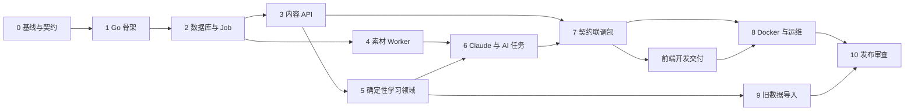

# 开发 Agent 实施提示词

## 1. 使用说明

本文件用于把 Web 化方案交给编码 Agent 分阶段执行。它不是前端视觉设计稿，也不要求 Agent 自行发明页面。

推荐使用方式：

1. 每次只执行一个阶段。
2. 将“公共上下文”与该阶段的“任务提示词”一起交给 Agent。
3. Agent 完成后，由独立审查者按该阶段验收项检查，再进入下一阶段。
4. 若仓库已有用户修改，Agent 必须保留并在其上工作，不能重置或覆盖。
5. OpenAPI、数据库迁移和领域行为发生变化时，必须同步更新对应文档和测试。

前端由前端开发负责。后端 Agent 只交付前端所需的稳定 API、错误语义、SSE 事件和本地联调环境，不设计具体页面。

## 2. 公共上下文提示词

将下面内容放在每一个编码任务前：

```text
你正在改造 AI 学习助教。当前系统是 Python CLI/TUI，本阶段目标是构建单用户、个人电脑部署的 Web 版。

已确认架构：
- 前端：React + TypeScript + Vite，由前端开发实现。
- 后端：Go + Gin，模块化单体。
- 异步任务：独立 Go Worker，通过 PostgreSQL jobs 表领取任务。
- 数据：PostgreSQL 是结构化数据和 Markdown 的唯一事实来源；文件卷保存上传、大文件、临时产物、导出和备份。
- AI：仅 Worker 读取 ANTHROPIC_API_KEY，通过 Anthropic Messages API 调用远程 Claude；Claude 模型不在本机容器内运行。
- 部署：Docker Compose，默认只监听 127.0.0.1:8080。
- 用户：单用户；第一阶段没有登录、多租户、公网部署、Redis、RabbitMQ 或微服务。

开始前完整阅读：
- docs/web-rebuild/README.md
- docs/web-rebuild/01-product-requirements.md
- docs/web-rebuild/02-frontend-handoff.md
- docs/web-rebuild/03-backend-architecture.md
- docs/web-rebuild/04-api-contract.md
- docs/web-rebuild/05-deployment-operations.md
- docs/web-rebuild/openapi.yaml
- 本任务列出的现有 Python 文件

工作规则：
1. 先检查 git status 和现有代码，不覆盖用户已有修改。
2. 先写失败测试，再写最少实现使测试通过；领域规则优先做表格驱动测试。
3. 保持 handler -> application service -> repository/domain 的依赖方向。Gin handler 不写 SQL、文件操作、Claude 调用或复杂业务规则。
4. API 以 api/openapi.yaml 为唯一外部契约。若实现发现契约有问题，先给出影响分析并同步修改契约、生成代码和契约测试。
5. 所有写操作明确事务边界；文件发布使用临时文件、校验和、原子重命名。
6. 不把 API Key、数据库密码、完整学习材料或 Claude 原始请求写入日志、错误响应、测试快照或 Git。
7. 不增加当前阶段不需要的基础设施或抽象。禁止自行引入微服务、Redis、消息队列、Kubernetes、GraphQL。
8. 子进程使用参数数组，不通过 shell 拼接用户输入；必须有超时、取消、输出大小限制和进程清理。
9. 结构化 AI 输出同时通过 JSON Schema 和领域校验；拒绝、截断、空输出和字段越界不得发布成成功结果。
10. 每次结束前运行本任务要求的测试、格式检查和静态检查。

交付报告必须包含：
- 修改的文件和行为。
- 新增/修改的数据库迁移与 API。
- 实际执行的命令及结果。
- 尚未解决的风险或依赖。
- 面向下一阶段的稳定接口。

遇到以下情况立即停止并报告，不要猜测：
- 需求与 OpenAPI/数据模型存在会破坏兼容性的冲突。
- 需要删除或重写用户已有数据。
- 需要真实 ANTHROPIC_API_KEY 才能继续自动化测试。
- 需要扩大到公网、多用户、认证或新的外部服务。
```

## 3. 阶段 0：现状基线与契约冻结

```text
任务：建立迁移前的可重复行为基线，不实现新业务功能。

重点阅读：
- docs/web-rebuild/00-current-python-architecture.md
- legacy/python/main.py
- legacy/python/src/models.py
- legacy/python/src/storage.py
- legacy/python/src/course_service.py
- legacy/python/src/exam_logic.py
- legacy/python/src/memory.py
- legacy/python/src/question_policy.py
- legacy/python/src/agent_runner.py
- legacy/python/tests/

执行：
1. 运行并记录当前 Python 测试基线。
2. 为出题数量、认知层次、客观题评分、连续答对/答错、薄弱点更新建立可移植的 JSON golden fixtures。
3. 为一套最小课程数据建立脱敏 legacy fixture，放入受版本控制的 `backend/testdata/legacy-fixtures/`，包含课程、课时、规范 `raw/`、历史 `raw_src/` 变体、笔记、试卷、作答、`wrong_questions/`、反馈、scores.json 和 weaknesses.json。
4. 校对 docs/web-rebuild/openapi.yaml 与 04-api-contract.md；实现确定性的 OpenAPI 生成步骤，把 `x-common-response-headers` 展开到每个 Response 后生成 `api/openapi.yaml`。服务端和前端代码生成只读取展开产物，CI 校验所有响应都有 `X-Request-ID`。
5. 创建 Makefile 的 verify-docs、verify-openapi 和 test-legacy 入口。

不得：
- 修改现有 Python 业务语义来让 fixture 更容易通过。
- 接触真实 `legacy-data/course/` 用户数据或把它加入 Git。
- 开始 Go handler、React 页面或 Docker 服务实现。

验收：
- 旧测试全部通过。
- fixture 中不含真实隐私数据和 secret。
- OpenAPI 可被标准解析器解析，所有内部引用可解析。
- README 说明如何重新生成/验证 fixture。
```

## 4. 阶段 1：Go 工程骨架与质量门禁

```text
任务：创建可编译、可测试的 Go 模块化单体骨架，不实现完整业务。

执行：
1. 创建 backend/go.mod、backend/cmd/api、backend/cmd/worker、backend/cmd/migrate、backend/cmd/legacy-import。
2. 创建 backend/internal/platform/config、httpserver、database、logging、clock、id。
3. 实现配置读取：普通配置来自环境变量，secret 支持 *_FILE；环境变量优先于文件。
4. 实现 /healthz 和 /readyz。healthz 只说明进程存活；readyz 检查数据库和迁移版本，不检查 Claude。
5. 统一 Problem Details 错误模型、request_id、panic recovery、访问日志、Host/Origin 校验、超时和 body 大小限制；默认同源且不启用通配 CORS。
6. 添加 gofmt、go vet、go test -race、静态检查和 OpenAPI 校验入口。
7. 为 api/worker 实现 SIGTERM 优雅关闭；测试正在处理的 HTTP 请求和 Worker 领取循环可停止。

设计要求：
- handler 依赖接口，测试不需要真实 PostgreSQL。
- 时间和 ID 生成器可注入。
- 日志结构化且有 secret/正文过滤测试。
- 不在业务包暴露 Gin 类型。

验收命令至少包含：
- gofmt 检查
- go vet ./...
- go test -race ./...
- OpenAPI 校验

完成标准：api 和 worker 均可启动；数据库不可用时 readyz 失败但 healthz 成功；没有空壳式“永远成功”检查。
```

## 5. 阶段 2：数据库、Repository 与任务队列

```text
任务：实现 03-backend-architecture.md 定义的数据库骨架和可靠 PostgreSQL Job Queue。

执行：
1. 创建版本化 migration，覆盖 courses、lessons、file_objects、materials、documents、questions、quizzes、quiz_items、attempts、attempt_answers、weaknesses、mastery_snapshots、summary_evaluations、jobs、job_events、ai_runs、idempotency_records、backups、system_state、legacy_import_batches、legacy_import_records。
2. 用约束表达可表达的不变量：外键、枚举/检查、唯一 course slug、唯一 quiz item position、每类文档每课时最多一个 active 版本，以及同一 Lesson/`generation_family` 最多一个活动 Job 的部分唯一索引。
3. 使用 sqlc 或项目选定的类型安全查询层；业务代码不散落手写扫描逻辑。
4. 实现事务辅助器和模块 Repository。
5. 使用 SELECT ... FOR UPDATE SKIP LOCKED 原子领取 Job，写入 lease_owner、lease_expires_at、started_at、attempt_count。
6. 实现心跳、租约回收、取消、可重试/不可重试分类、指数退避和 job_events。
7. 实现进程内通知 + 数据库回查的 SSE 事件源；通知丢失时仍以数据库为准。事件历史断档时发送独立 `stream.resync_required` Envelope 和持久化事件高水位，不伪造 JobEvent。
8. `system_state` 实现 Maintenance Owner Lock、Business Gate、数据库时间租约和心跳；`maintenance-repair` 只在 Owner Lock 可获取且租约过期时回收过期 Job lease、执行 temporary file Recovery，再原子修复遗留维护状态和 `backups.creating`。普通 doctor 只读。

关键测试：
- 多个 Worker 并发领取时，同一 Job 不重复领取。
- Worker 崩溃后，租约过期任务可恢复。
- max_attempts 后进入 failed，不无限重试。
- 已请求取消的 Job 不再开始；运行中取消可传播。
- 领域写入与 Job 创建在同一事务中提交或回滚。
- 不同 Idempotency-Key 并发创建同一 Lesson/任务族时只有一个成功，另一个稳定返回现有 `active_job_id`。
- Backup 被 SIGKILL 后，租约未过期或 Owner Lock 仍被持有时 maintenance-repair 不清理；确认过期后先回收 Job/file Owner，再只清理对应 Backup Owner 并留下审计。
- 非 Job POST 也通过通用 idempotency_records 回放首次响应；覆盖并发 in_progress、不同 body 冲突、过期和文件两阶段恢复。
- migrations 能从空库 up；支持项目约定的 down/恢复策略。

不得使用内存队列作为事实来源，不引入 Redis/RabbitMQ。
```

## 6. 阶段 3：课程、课时、素材与文档 API

```text
任务：实现课程内容主链路的 REST API，不接 Claude。

实现范围：
- Course API
- Lesson API
- Material 文本/URL/文件上传入口
- Document 查询与版本发布基础能力
- Lesson 导出 Job 创建入口

执行：
1. 从 api/openapi.yaml 生成或校验服务端类型，禁止另建不兼容 DTO。
2. 实现 application service 和 repository；handler 只做绑定、调用和响应映射。
3. 严格使用接口契约的稳定错误码，包括 `validation_error`、`not_found`、`resource_busy`、`upload_too_large`；禁止在实现中发明近义错误码。
4. 文件上传流式写入临时目录，同时计算 SHA-256；按后端文档的 temporary row -> 原子移动 -> ready/link 两阶段协议发布，并实现崩溃恢复。请求失败不得留下不可对账的正式对象。
5. URL 只在 API 中做协议/白名单安全校验，不下载内容；实际处理交给后续 Worker Job（由 Claude Web Fetch 提取）。
6. 文本素材写入 PostgreSQL 或按架构定义落库，同时创建 lesson_import Job。
7. 乐观并发使用版本号或 If-Match；重复 Idempotency-Key 返回同一结果。
8. 素材导入、内容重生成、普通出题和复习出题统一属于 `lesson_generation`；同一 Lesson 已有活动生成 Job 时映射数据库唯一冲突为 `409 resource_busy`，不能排队覆盖、基于变化中的内容出题或重复调用 Claude。

安全测试：
- 拒绝非 HTTPS、非允许站点、localhost、私网、link-local，以及重定向到私网的 URL。
- 拒绝路径穿越、伪造扩展名、超限请求和异常 multipart。
- 删除被试卷/作答引用的课时必须返回冲突或执行明确软删除规则。

验收：无需 Claude Key 即可完成课程 CRUD、素材入队、文档查询和错误契约测试。
```

## 7. 阶段 4：Worker 素材管线与文件存储

```text
任务：实现素材的安全解析与标准化文本产出，暂不实现 Claude 内容生成。

执行：
1. 实现 Worker Runner、任务注册表、按任务类型的 handler 和每阶段进度事件。
2. 实现 file store：object key 不使用用户文件名；数据库记录 hash、size、media_type、状态和引用。
3. 文本素材规范化为 UTF-8，保留来源和时间戳。
4. 文档素材支持 P0 规定的 PDF/DOCX/TXT/Markdown；记录解析器版本和警告。
5. URL 素材由 Claude Web Fetch server tool 提取原文（Worker 先做 canonicalClaudeURL 规范化与白名单校验），元数据记 Extractor=claude_web_fetch、ParserVersion=claude-web-fetch/v1；ffmpeg/yt-dlp 仅用于上传媒体，执行时使用参数数组、非 root、超时、取消和输出限制。
6. 上传音视频没有字幕时，按 TRANSCRIPTION_MODE：subtitle_only 返回 transcript_required；whisper_local 才调用本地 Whisper。
7. 文本过长时按可复现规则分块，记录 chunk 顺序、hash 和 token 估算。
8. 临时目录按 job_id 隔离，成功/失败/取消都清理可重建文件。

关键测试：
- parser 使用脱敏小 fixture，不依赖互联网。
- 用 fake process runner 测试超时、取消、非零退出、超大 stdout/stderr。
- URL 校验测试覆盖非白名单、追踪参数剥离与超长 URL；不再做本地下载集成测试。
- 同一文件重复上传复用对象但不错误合并业务引用。
- 发布中断不产生数据库指向不存在文件的状态。

不得让解析器执行素材中的脚本、宏或命令。
```

## 8. 阶段 5：试卷、作答与确定性学习领域

```text
任务：先迁移不依赖模型供应商的完整学习领域，并用阶段 0 golden fixtures 保持可解释的行为兼容。本阶段不调用 Claude。

执行：
1. 迁移 question_policy 的题量、难度、认知层次和停止练习规则，解决低掌握度约束冲突并写决策记录。
2. 实现常规试卷与复习试卷两个应用用例；复习模式显式接受 weakness/历史错题上下文。
3. 定义模型无关的 QuestionDraft、GradingDraft 和领域校验/应用接口；输入可由 fixture/fake 提供。
4. Question 是不可变版本；Quiz 发布后题目、顺序和分值不可修改，编辑创建新版本。
5. 实现 Attempt 创建、逐题自动保存、版本冲突、提交幂等和提交后只读。单题 answer_version 首次为 0；成功保存递增单题版本和 Attempt 提交版本，不同题可并发。
6. 客观题由确定性 Go 逻辑评分；主观题提交只创建 attempt_grade Job，不在本阶段实现其 AI handler。
7. 实现批阅结果的幂等应用、weakness evidence、formula-versioned mastery snapshots、进度/薄弱点查询。
8. Submit 使用两个强类型响应：全客观题 `200 AttemptSubmitCompleted` 不含 Job，主观题 `202 AttemptSubmitAccepted` 必含 Job。实现幂等的 `POST /attempts/{attempt_id}/grading-jobs`，允许 `grading_failed` Attempt 在没有活动批阅任务时重新创建 Job。

关键不变量：
- 多选题比较规范化集合，不能受顺序影响；未答题与错误答案语义不同。
- 主观题未批阅前不得显示伪造总分。
- 同一 Attempt 提交两次只产生一个批阅 Job。
- 同一批阅结果重复消费不重复增加 weakness、成绩或 mastery snapshot。
- Attempt 始终返回不可变 Quiz 的学生可见题目；标准答案只在允许的反馈状态出现。

测试：
- 与 Python golden fixture 对比确定性规则。
- application service 事务测试覆盖提交、批阅结果成功/失败/重复消费。
- HTTP 契约测试覆盖 autosave 首次版本 0、并发不同题、同题 409、submit 200/202 Schema、grading_failed、Job Retry 和无旧 Job ID 的 Attempt 重新批阅。
- mastery snapshot 记录 formula_version/components/source_attempt_id，重复消费同一批阅结果不新增快照。
```

## 9. 阶段 6：Claude 集成与 AI 任务

```text
任务：在 Worker 中实现 Anthropic Claude Provider，并把结构化结果接入阶段 5 已稳定的领域接口。

执行：
1. 定义 backend/internal/ai Provider 接口和 Anthropic adapter；领域模块不依赖供应商 SDK 类型。
2. API Key 仅从 ANTHROPIC_API_KEY_FILE/ANTHROPIC_API_KEY 读取，部署默认使用文件；API 进程不能读取。缺失/空 Key 只降级 AI 能力。
3. 实现 claude_connectivity_test、lesson_import/lesson_regenerate、quiz_generate/review_quiz_generate、attempt_grade、wrong_answer_analyze、summary_evaluate handlers。
4. lesson extraction 基于标准化文本生成 teacher_outline、student_notes 和结构化元数据；大素材先分块提取事实再受控合并。
5. Quiz/Grading/Summary 输出只进入阶段 5 的 Draft 校验和结果应用接口，Claude adapter 不直接写领域表。
6. 提示词与 JSON Schema 版本化；ai_runs 记录 provider、model、prompt/schema version、usage、request_id、延迟和状态。
7. 处理 refusal、max_tokens、超时、429、5xx、无效 JSON、Schema/领域校验失败；瞬时错误重试，认证/请求错误不无限重试。
8. 文档/Quiz/批阅结果只在业务事务成功后发布，失败保留旧 active 内容和已提交 Attempt。

测试：
- 所有 Claude 测试使用 fake HTTP server/Provider，CI 不需要真实 Key。
- 固定测试 refusal、截断、Retry-After、超时、非法 Schema、越界分数、prompt 注入和结果重复消费。
- 日志/错误快照断言不含 Key、Authorization、完整 Prompt 或正文。

真实 Claude 冒烟测试必须显式 opt-in，不属于默认测试门禁。
```

## 10. 阶段 7：SSE、契约完整性与前端联调包

```text
任务：使前端开发能够只依据契约稳定联调；不设计或实现具体页面。

执行：
1. 补齐 api/openapi.yaml 中所有已实现路径、schema、example、错误响应和 operationId。
2. 实现 /api/v1/jobs/stream；持久化事件使用独立 `JobStreamData`，`stream.resync_required` 和无 id 的 `heartbeat` 使用各自强类型 Envelope，支持 Last-Event-ID 和断线重连。不得复用 REST 审计 `JobEvent` 作为 SSE data。
3. SSE 只发送状态事实，不承诺每个 progress 事件都不丢；历史游标过期时发送当前高水位和 `active_jobs_url`，客户端通过 REST 恢复最终状态后继续订阅。
4. 为前端生成 TypeScript API types/client，生成物可重复生成且不得手改。
5. 提供 Mock Service Worker 或等价 mock 数据：首次空状态、导入中、导入失败、考试保存冲突、批阅中、批阅失败、完成。
6. 提供本地 seed 命令和脱敏 demo 数据，不需要 Claude Key即可演示主要只读/答题流程。
7. 增加 OpenAPI breaking-change 检查和后端响应契约测试。

前端交接物：
- api/openapi.yaml
- 生成客户端命令和版本
- 错误码表
- SSE 事件表和重连示例
- demo seed/mock
- Docker 联调启动命令

不得输出页面布局、品牌方案或组件视觉规范；这些由前端开发根据 02-frontend-handoff.md 决定。
```

## 11. 阶段 8：Docker、备份恢复与发布门禁

```text
任务：实现 05-deployment-operations.md 的个人电脑部署方案。

前置条件：前端开发已交付可构建的 `frontend/`。若尚未交付，只完成 API/Worker/Tools/Compose 基础设施并明确阻塞 Web 镜像与浏览器 E2E，不生成临时页面冒充前端成果。

执行：
1. 创建 API、Worker、Web 多阶段 Dockerfile；运行时非 root，固定基础镜像主版本。
2. 创建 deploy/compose.yaml、Caddyfile、.env.example 和 secrets README；备份/恢复使用独立 Tools 镜像，不把 PostgreSQL client 和归档工具装入 API 镜像。
3. 只有 Web 发布 127.0.0.1 端口；数据库不发布端口；只有 Worker 挂 Anthropic secret 并具有出网网络。
4. migration 作为一次性服务：db healthy -> migrate success -> api/worker；web 等待 api healthy。
5. 实现只读 doctor、具有数据卷写权限的 manual maintenance-repair、backup、restore 和 legacy-import 一次性服务。旧目录只读挂载，目标数据/报告目录显式读写；备份包含 database.dump、files、manifest 和 checksums。
6. 实现 Maintenance Owner Lock、Business Gate、租约心跳和一致性备份；SIGKILL 后 maintenance-repair 仅在锁空闲且租约过期时回收过期 Job/file Owner，随后原子把 creating Backup 标记失败并恢复 normal。恢复前校验并要求明确目标确认。
7. 添加容器级冒烟测试：重启保留数据、强杀 Worker 后任务恢复、SSE 通过代理、不泄漏 secret。
8. 生成 SBOM 并运行镜像/依赖安全扫描；为无法立即修复的项记录风险。

验收：
- 从空环境按文档命令可启动。
- docker compose config 成功且不包含 secret 内容。
- curl healthz/readyz 成功。
- 使用 fake Claude 服务可完成导入 -> 文档 -> 出题 -> 答题 -> 批阅闭环。
- 备份能恢复到新的空数据卷并通过 doctor。
- 备份 quiesce 通过长上传、活动 Job、temporary 文件发布和任一步骤崩溃的故障注入测试。
- 强杀 Backup/主机重启演练证明维护状态可安全恢复，不会误清理仍持有 Owner Lock 的慢备份。
- `legacy-import scan` 不产生业务写入，`/legacy` 在容器内不可写。
- docker compose down 后数据存在；文档明确禁止日常 down -v。

不要在镜像、构建参数、前端产物或 Compose environment 中写死真实 Key。
```

## 12. 阶段 9：旧数据导入与切换

```text
任务：实现 legacy-import，将 `legacy-data/course/` 和 `legacy-data/.tasks/` 安全迁移到 PostgreSQL 和新文件卷。

完整阅读 docs/web-rebuild/07-migration-roadmap.md 后执行。

执行：
1. 扫描模式只读旧目录，输出 manifest、识别结果、冲突和警告，不写新系统。
2. 导入模式使用 staging/import batch；每个文件计算 hash，并记录 source_path、source_hash、importer_version 和目标 ID。
3. 导入 `legacy-data/course/` 下科目、lesson_XX/info.json、规范 raw、历史 raw_src 变体、教师/学生笔记、quiz、answers、wrong_questions、feedback、scores.json、weaknesses.json、summary，以及 `legacy-data/.tasks/` 审计记录。
4. 为不完整、重复和历史格式建立明确映射/隔离规则；不得静默丢弃。
5. 导入幂等：同一批次重跑不复制；源文件变化要生成新差异报告，不覆盖用户确认后的目标记录。
6. 活动 .tasks 不直接当成新 jobs 继续执行；记录为 legacy task，并要求用户在新系统显式重建可恢复任务。
7. 旧 `ai_grading.pending/failed` 映射为 `grading_failed + legacy_task_not_resumable`，`grading_job_id/final_score/graded_at` 为空；输入完整时通过 Attempt 级 grading-jobs API 重新批阅，输入不完整时隔离。
8. 输出 reconciliation report：源/目标课程数、课时数、文档数、试卷数、attempt 数、分数与 weakness 对账。
9. 提供 --dry-run、--course、--fail-on-warning 和机器可读 JSON 报告。

验收：
- 对阶段 0 fixture 重复导入两次，目标计数不变。
- 任何解析错误含源路径和稳定错误码，但不暴露材料正文。
- 对账失败时不允许标记批次 completed。
- 导入工具从不修改旧目录。
```

## 13. 阶段 10：整体验收与安全审查

```text
任务：作为发布审查者验证系统，不新增未经批准的功能。

审查范围：
1. PRD P0 每项都有 API、实现和自动化测试证据。
2. OpenAPI 与真实响应一致，错误码、nullable、分页、幂等和 SSE 可恢复行为一致。
3. 数据库约束和事务保证文档中的不变量。
4. Worker 并发、租约恢复、取消、重试和结果幂等通过故障注入。
5. Claude 拒绝/截断/限流/超时/Schema 失败不会发布脏数据。
6. 上传、URL、Markdown、子进程、日志和 secret 通过安全测试。
7. Compose 网络、端口、权限、secret、健康检查和启动顺序符合文档。
8. 备份恢复在空环境演练成功。
9. legacy-import 对账完成，旧 Python 数据仍保持只读可回退。
10. 前端开发交接包完整，但不审查具体视觉方案。

输出 findings first，按 P0/P1/P2 排序，每项给文件/行号、复现方式和影响。没有问题时也要明确列出未覆盖的残余风险。不要因为接近发布日期而降低门槛。
```

## 14. 修复 Agent 提示词模板

```text
你只修复下面列出的已确认问题，不做顺手重构：

<粘贴 finding、复现步骤和期望行为>

要求：
1. 先复现并新增失败测试。
2. 说明根因，不以增加重试或吞错代替修复。
3. 修复后运行受影响模块测试和全量门禁。
4. 若修改外部行为，同步 OpenAPI、接口文档和兼容说明。
5. 保留用户已有修改，不重置工作树。
6. 报告实际验证输出和残余风险。
```

## 15. 给前端开发的任务说明模板

这段交给前端开发，不要求后端 Agent 执行：

```text
请基于 docs/web-rebuild/01-product-requirements.md 和 02-frontend-handoff.md 完成 React 前端的信息架构、交互与视觉设计。后端契约以 api/openapi.yaml 为准，不自行猜测接口字段。

必须优先保障：
- 导入和 AI 任务全过程可观察，刷新/断线后能恢复状态。
- 学习材料长文阅读舒适，Markdown 安全渲染。
- 答题自动保存清晰、无跳动，提交前强制同步。
- 批阅中、失败、重试、部分结果和空状态都有完整体验。
- 键盘、焦点、屏幕阅读器、减少动画和移动端可用性达到交接文档验收标准。

请先提交：
1. 页面/路由信息架构。
2. 核心流程原型和状态矩阵。
3. 设计 token 与组件清单。
4. API/SSE 适配方案和错误映射。
5. Playwright 关键路径计划。

视觉方案由你负责，但不能改变产品状态机、API 语义或安全边界。发现契约缺口时记录具体 use case、期望请求/响应和兼容影响，交给后端评审后再修改。
```

## 16. 阶段依赖



阶段 3 和阶段 4 在数据库/Job 契约稳定后可并行；其余阶段保持依赖顺序。任何阶段未通过验收，不把问题留给后续阶段掩盖。
