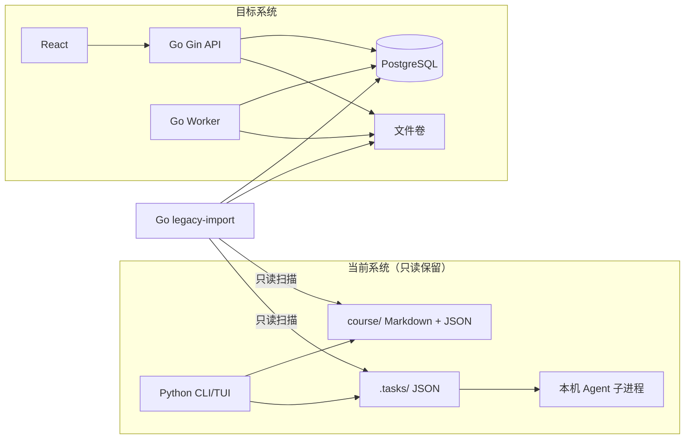

# 旧系统迁移与发布路线图

## 1. 目标与原则

本路线把当前 Python CLI/TUI 的能力和本地文件数据迁入 Go + Gin、React、PostgreSQL 和独立 Go Worker，并始终保留可验证、可回退的旧数据副本。

- 采用旁路建设和最终切换；迁移初期不移动现有 Python 文件。
- 旧 `course/`、`.tasks/` 在导入全过程只读。
- 先迁移确定性领域规则和 API 契约，再接 Claude 和 Docker。
- 任何旧记录要么成功映射，要么进入带原因的隔离报告，不能静默跳过。
- 导入可 dry-run、可重复、可对账；不以退出码为 0 代替一致性验证。
- 切换前备份；切换失败时恢复旧入口和旧目录，不在损坏的新库上继续手工修补。

## 2. 当前与目标边界



迁移期禁止 Python 和 Go 同时写同一份业务数据。开发/演练阶段两套系统使用不同数据目录；最终切换时先停止旧系统写入，再做最后一次导入。

## 3. 代码能力映射

| 当前 Python 模块 | 当前职责 | 目标 Go 模块 | 迁移方式 |
| --- | --- | --- | --- |
| `main.py`、`interactive.py` | 命令和终端交互 | React + Gin handler | 不逐行翻译；按 PRD/API 重建用例 |
| `course_service.py` | 课程、课时、导入和组卷编排 | `course`、`lesson`、`material`、`quiz` service | 保留用例语义，移除终端输出和文件细节 |
| `models.py` | Pydantic 模型 | Go domain types + DB constraints + OpenAPI | 建立字段映射与 golden fixture |
| `storage.py` | Markdown/JSON 存储 | Repository + file store | Importer 读旧文件；运行时不做双写 |
| `question_policy.py` | 题量和认知策略 | `internal/quiz/policy` | 表格测试后等价迁移，并处理已知策略矛盾 |
| `exam_logic.py` | 组卷、答题、判分、批阅、导出 | `quiz`、`attempt`、`mastery`、`document`、`job` | 按领域拆分；确定性逻辑先于 AI |
| `memory.py` | 成绩、薄弱点、掌握度 | `mastery` Repository/Service | 导入历史证据；派生值可重新计算 |
| `agent_runner.py` | 文件任务队列和 Agent 子进程 | PostgreSQL Job Queue + Worker | 不续跑旧任务；只迁移审计状态 |
| `material_parse/` | 文档/字幕/音视频解析 | Worker material pipeline | 以安全子进程和 parser 接口重建 |
| `ai_adapter/`、`prompts.py` | AI 调用和提示词 | `internal/ai` + 版本化 prompts/schemas | 正式路径收敛为 Anthropic Adapter |
| `process_tasks.py` | 人工处理/重试任务 | Job API + Worker recovery | 用租约、错误分类和重试替代 |

## 4. 数据发现与 Manifest

`legacy-import scan` 先生成只读 Manifest：

```json
{
  "schema_version": 1,
  "source_root_fingerprint": "sha256:...",
  "source_created_at": "2026-07-17T12:00:00+08:00",
  "importer_version": "0.1.0",
  "counts": {
    "courses": 0,
    "lessons": 0,
    "files": 0,
    "quizzes": 0,
    "attempts": 0,
    "wrong_question_files": 0,
    "weaknesses": 0,
    "scores": 0,
    "tasks": 0
  },
  "files": [
    {
      "relative_path": "subject/lesson_01/info.json",
      "size": 123,
      "sha256": "...",
      "kind": "lesson_info",
      "parse_status": "valid"
    }
  ],
  "warnings": []
}
```

扫描要求：

- Manifest 不保存正文、答案、API Key 或宿主机绝对路径。
- 路径必须解析到 source root 内，拒绝符号链接逃逸。
- 记录未知文件；大文件流式计算 hash，不整体读入内存。
- JSON 失败记录相对路径、hash、错误位置和稳定错误码。
- 大小写不敏感文件系统上的路径冲突必须提前报告。

## 5. 导入批次与幂等

迁移新增两张内部表，不对浏览器公开。

### `legacy_import_batches`

- `id`、`source_root_fingerprint`、`manifest_sha256`、`importer_version`。
- `status`：`scanned | importing | needs_review | completed | failed`。
- `started_at`、`completed_at`、`report_json`。

### `legacy_import_records`

- `batch_id`、`source_relative_path`、`source_sha256`、`source_kind`。
- `target_kind`、可空 `target_id`。
- `status`：`imported | deduplicated | quarantined | skipped_by_policy`。
- `reason_code`、`details_json`。
- 唯一键：`(batch_id, source_relative_path, source_sha256, target_kind)`。

幂等规则：

- 同一 Manifest 重跑复用原批次，不新增业务副本。
- 同路径同 hash 视为已处理。
- 同路径 hash 变化生成差异，默认 `needs_review`，不覆盖新系统已有修改。
- 二进制文件可按 SHA-256 去重；课程、文档和试卷不能只按内容 hash 合并。
- 源到目标映射只保存在 `legacy_import_records.target_kind/target_id`，不向业务表复制 `legacy_source_ref` 或宿主机路径。

## 6. 数据映射

### 6.1 科目与课时

| 旧来源 | 新目标 | 规则 |
| --- | --- | --- |
| `course/{dir}/.subject` | `courses` | 目录表示候选课程；标题优先取目录内 `info.json.subject` |
| `{dir}` | `courses.slug` | 作为候选；冲突时追加稳定短 hash，不覆盖已有课程 |
| `lesson_XX/` | `lessons.ordinal` | `XX` 必须为正整数；与 `info.json.lesson` 不一致时隔离 |
| `info.json.subject` | `courses.title` | 同目录出现多个 subject 时批次进入 review |
| `info.json.name` | `lessons.title` | 缺失时使用“第 N 课”并产生 warning |
| `info.json.created_at` | `lessons.created_at` | 合法时间直接转换；缺失时用 mtime 并标记推断 |
| 其他白名单字段 | `lessons.metadata` | topics、difficulty、duration 和 audience；源路径只留在 import records |

Course/Lesson 使用新 UUID，不复用可变名称。Importer 保存稳定 source ref 到 UUID 的映射。

### 6.2 原始素材和文档

| 旧来源 | 新目标 | 规则 |
| --- | --- | --- |
| `raw/raw_text.md` | `materials` + `documents(kind=raw_text)` | 当前规范路径，记录 hash 和来源 |
| `raw_src/all_raw_text.txt` | `materials` + raw_text 文档版本 | 历史聚合文本候选 |
| `raw_src/source_text.md` | `materials` + raw_text 文档版本 | 历史直接文本候选 |
| `raw_src/source_material.md` | `materials` + raw_text 文档版本 | 历史素材文本候选 |
| `raw_src/video_info.json` | `materials.metadata` | 校验 bvid/cid/title/duration 等白名单元数据 |
| `raw_src/collected_info.txt` | `materials.metadata` 或迁移附件 | 按格式识别，不把采集说明误作正文 |
| `raw_src/README.md` | 不导入 | 工具说明文件，记录 `skipped_by_policy` |
| 历史字幕、音视频和其他 `raw_src/` 文件 | `file_objects` + `materials` | 按 MIME/schema 识别，不只依赖文件名 |
| `teacher_notes/content.md` | `documents(kind=teacher_outline)` | 旧目录名映射为目标文档类型，作为版本 1、active |
| `student_notes/content.md` | `documents(kind=student_notes)` | 作为版本 1、active |
| `export.md` | 不导入 | 可重建派生产物，记录 `skipped_by_policy` |
| `summary_result.json` | `summary_evaluations` | 通过兼容 schema 才导入，否则隔离 |
| 原始上传文件 | `file_objects` + `materials` | 流式复制到 staging，核对 hash 后原子发布 |

旧记录没有 prompt/model/version 时写 `legacy-unknown`，不能伪造当前 Claude 调用。旧笔记不创建假的 `ai_runs` 成功记录。

Raw 文本候选全部进入 Manifest，不能因为找到第一个文件就停止扫描。内容相同按 hash 去重；内容不同时创建多个 `raw_text` 文档版本，active 优先级为：`raw/raw_text.md` > `raw_src/all_raw_text.txt` > `raw_src/source_text.md` > `raw_src/source_material.md`。候选语义不明确时产生 warning，允许 resolution 显式指定 active 版本。

### 6.3 试卷与题目

候选文件必须通过 Quiz schema 识别，不能只按 `quiz*.json` 文件名判断。

- 每个旧 Quiz 生成新 `quizzes`，旧 quiz ID 作为 source ref，不作全局主键。
- Questions 按 Quiz 快照导入；不同 Quiz 中相同 question ID 不错误共享可变题目。
- `quiz_items.position` 使用旧数组顺序。
- `type`、`cognitive_level` 使用白名单；未知值隔离整份 Quiz。
- 选项、答案、解析、tested concepts 和分值执行与新生成题相同的领域校验。
- `source=regular | retest | assembled` 保留；缺失时默认 regular 并 warning。
- assembled 的 `source_quizzes` 无法解析时保留审计字符串，不创建虚假外键。

### 6.4 作答、批阅和反馈

作答文件按字段识别，至少包含 `quiz_id` 和 answers。迁移顺序：

1. 解析唯一 Quiz；找不到或存在歧义时隔离 Attempt。
2. 创建 `attempts`，保留旧时间、自动评分和连续答题统计。
3. 每个答案必须匹配该 Quiz 的题目；未知题目会隔离 Attempt。
4. `ai_grading.status=pending/failed` 均映射为 `attempts.status=grading_failed`，保留已提交答案和可验证的客观题暂定分；`grading_job_id=NULL`、`final_score=NULL`、`graded_at=NULL`，`grading_error_code=legacy_task_not_resumable`，detail 只保存脱敏来源状态。`submitted_at` 使用可验证旧提交时间，缺失时使用 Import Batch 时间并记录 warning。Importer 不自动创建新 Job。
5. 唯一 feedback/grade result 通过逐题分值和总分校验后导入。
6. 完成记录关联 weakness evidence；Importer 不再次执行“增加严重度”的运行时副作用。

多个反馈候选无法确定时禁止默认取最新文件，必须生成冲突报告。

### 6.5 `scores.json`

每条历史成绩按 course、lesson、timestamp、score/total 匹配 Attempt。只有一个候选时作为对账信息，不重复创建成绩；零个或多个候选分别记为 `unmatched_score`、`ambiguous_score`。第一阶段不为无法证明来源的聚合分数伪造 Attempt。

### 6.6 `weaknesses.json`

- 按 `(course, chapter, normalized concept)` 导入，保留旧 ID/source ref。
- severity 必须在 1..5，越界时隔离而非自动截断。
- first_seen、last_seen、review_count、mastered 原样保留。
- 能唯一关联 Attempt/Question 时建立结构引用，否则保留为 legacy evidence 并标记未关联。
- 规范化后冲突时不直接相加严重度，形成合并差异供确认。
- Attempts/Weaknesses 对账完成后，使用明确的 `legacy-import-v1` 公式生成可追溯 mastery snapshot；证据不足时 mastery 保持 null，不伪造趋势点。

### 6.7 `wrong_questions/`

当前历史文件可能是 JSON 数组，每项包含 `question_id`、题干、用户答案、正确答案、解析、分值、难度、认知层次和知识点。Importer 必须：

1. 按 schema 识别 `wrong_questions/*.json`，Markdown/其他格式也进入 Manifest。
2. 使用文件名时间、question_id、Quiz 和答案内容匹配已导入 Attempt/AttemptAnswer。
3. 唯一匹配时作为对账/legacy evidence，不重复创建答案或再次增加 weakness severity。
4. 与 Attempt 数据冲突时生成字段级差异，禁止静默覆盖。
5. 无法匹配时标记 `quarantined`，保留源 hash 和只读归档引用；最终 `--fail-on-warning` 必须通过 resolution 明确接受或映射。
6. 历史独立错题分析正文保存在受限 legacy import record，并进入导出/归档报告；不能丢弃或误当普通笔记。

对账报告单列 wrong question 文件、条目、唯一匹配、冲突和未匹配数量。

### 6.8 `.tasks`

旧任务只迁移审计，不迁移为可执行 Job：

- 记录 type、status、创建时间、源 hash、声明输出和脱敏错误摘要。
- 不通过公开 API 暴露旧 prompt 正文。
- pending/failed 显示“旧任务需要重新发起”。
- 旧 Attempt 批阅由用户调用幂等的 `POST /api/v1/attempts/{attempt_id}/grading-jobs` 创建当前 `attempt_grade` Job；其他任务由对应的新 API 重新发起。

旧任务依赖文件路径、Agent 命令和输出约定，直接续跑无法满足新 Worker 的幂等、租约、安全和结构化输出不变量。

### 6.9 Docker 执行边界

Importer 通过 `manual` profile 的一次性 `legacy-import` 服务执行：

```bash
docker compose --env-file deploy/.env -f deploy/compose.yaml \
  --profile manual run --rm legacy-import \
  scan --source /legacy --report /reports/scan.json --fail-on-warning

docker compose --env-file deploy/.env -f deploy/compose.yaml \
  --profile manual run --rm legacy-import \
  import --source /legacy --report /reports/import.json --resolution /reports/resolution.json
```

Compose 必须把宿主机旧目录挂载为 `/legacy:ro`，把新系统文件目录和报告目录显式挂载为 `:rw`。`scan` 不写数据库和文件卷；`import` 只能写 staging batch、目标数据卷和报告目录。容器使用非 root 用户、只读根文件系统、`cap_drop: ALL`，且不获得 Anthropic secret。

## 7. 冲突与隔离

| 原因码 | 含义 | 默认处置 |
| --- | --- | --- |
| `invalid_json` | JSON 不能解析 | 隔离文件 |
| `unsupported_schema` | 不符合已知版本 | 隔离记录 |
| `path_escape` | 符号链接/路径越界 | 中止批次 |
| `course_identity_conflict` | 目录内科目身份不一致 | 人工确认 |
| `lesson_number_conflict` | 目录编号和 info 不一致 | 隔离课时 |
| `duplicate_business_key` | 目标已存在不同对象 | 不覆盖，生成差异 |
| `missing_quiz` | Attempt 找不到 Quiz | 隔离 Attempt |
| `unknown_question` | Answer 找不到题目 | 隔离 Attempt |
| `ambiguous_feedback` | 多个反馈无法确定 | 隔离反馈 |
| `unmatched_score` | 成绩找不到作答 | 保留对账记录 |
| `ambiguous_score` | 成绩对应多个作答 | 保留对账记录 |
| `invalid_score_range` | 题分/总分越界 | 隔离批阅 |
| `legacy_task_not_resumable` | 旧任务不能安全续跑 | 记录并提示重建 |
| `legacy_grading_input_incomplete` | 旧 Attempt 缺少可重新批阅的题目或答案 | 隔离 Attempt，不开放重新批阅 |

`--fail-on-warning` 用于验收和最终切换。人工决定写入单独 resolution 文件；该文件进入 Manifest 并计算 hash，确保决定可审计、可重放。

## 8. 实施里程碑

### M0：冻结行为基线

交付 Python 测试基线、确定性规则 golden fixtures、脱敏迁移 fixture 和 OpenAPI 校验。退出条件：确定性规则在无 Claude、无网络环境下可复现。

### M1：新系统底座

交付 Go 进程、migration、Repository、Job Queue、健康检查和错误模型。退出条件：空库可建立，并发领取、租约恢复、事务和取消测试通过。

### M2：非 AI 内容主链路

交付 Course/Lesson/Material/Document API、文件存储、解析管线和前端 mock。退出条件：无真实 API Key 可创建课程、导入文本、观察任务和阅读已导入文档。

### M3：学习闭环

交付 Quiz、Attempt、客观评分、Weakness/Mastery、总结用例。退出条件：Go 规则通过 Python golden fixtures，提交和结果消费幂等。

### M4：Claude 闭环

交付 Anthropic Adapter、版本化 prompt/schema、extraction/quiz/grading handlers。退出条件：fake Provider 故障矩阵通过；真实 Key 冒烟测试显式 opt-in。

### M5：Importer

交付 scan、dry-run、import、reconcile、resolution 和两种报告。退出条件：fixture 重复导入无重复；所有源记录都有明确处理状态。

### M6：Docker 与前端联调

交付 Compose、备份恢复、Caddy、TypeScript client、seed/mock；前端开发实现 UI。退出条件：空环境可启动，P0 链路通过代理完成，备份可恢复。

### M7：预切换演练

1. 对旧数据做文件级快照。
2. 执行 scan 和 `--dry-run --fail-on-warning`。
3. 处理 resolution。
4. 导入临时空数据库/文件卷。
5. 对账、抽样、Web 关键路径和恢复演练。

退出条件：P0 阻断为 0；warning 全部有记录；对账通过；旧目录未变化。

### M8：最终切换

1. 停止 Python CLI、`process_tasks.py` 和仍会写旧目录的 Agent 子进程。
2. 创建旧目录只读快照与校验和。
3. 对最终目录重新 scan，确认与演练后的预期差异一致。
4. 执行最终导入和 `--fail-on-warning` 对账。
5. 启动 Web 栈，运行 doctor 和关键路径验收。
6. 日常入口切换为 `http://127.0.0.1:8080`。
7. 旧目录只读归档，至少保留一个发布观察周期。

## 9. 对账要求

报告同时展示源、导入、去重、隔离、策略跳过数量：

| 对象 | 源 | 导入 | 去重 | 隔离 | 跳过 |
| --- | ---: | ---: | ---: | ---: | ---: |
| Courses / Lessons |  |  |  |  |  |
| Materials / Documents |  |  |  |  |  |
| Quizzes / Questions |  |  |  |  |  |
| Attempts / Answers / Feedback |  |  |  |  |  |
| Wrong-question files / items |  |  |  |  |  |
| Weaknesses / Scores |  |  |  |  |  |
| Legacy tasks |  |  |  |  |  |

必须检查：

- Lesson 均指向存在的 Course。
- active Document 内容存在且 hash 一致，同类同课时只有一个 active 版本。
- Quiz item 指向发布快照中的 Question；Attempt answer 属于对应 Quiz。
- 每个 legacy wrong-question item 都有唯一 Attempt 对账、显式 resolution 或 quarantined 记录。
- 完成批阅的逐题分数之和与总分一致，或有明确 legacy rounding 说明。
- 文件数据库引用与文件卷双向核对，无缺失正式对象和孤立 staging 文件。
- 同一批次的 legacy source ref 唯一。
- 对账失败时批次不能进入 `completed`。

## 10. 切换验收

- 课程/课时创建、重命名、删除及冲突路径。
- 文本、文件、URL 导入；无字幕音视频返回可行动错误。
- Teacher/Student 文档阅读和版本历史。
- 常规组卷与复习组卷语义不同。
- 自动保存、刷新恢复、版本冲突、幂等提交。
- 客观评分、主观批阅、失败重试、Weakness 和历史 Attempt。
- 导入的 pending/failed 批阅显示为 `grading_failed`，可通过 Attempt 级接口创建新批阅 Job；输入不完整时明确不可重试。
- Worker 强杀后租约恢复；重复执行不重复业务副作用。
- SSE 重连后可由 REST 恢复最终状态。
- 无 Claude Key 时系统可启动并明确降级，只禁用 AI 动作。
- 备份、恢复和回滚演练成功。

## 11. 回滚

### 切换前

新系统未成为日常入口时，可丢弃测试数据库/卷；旧系统不受影响。不得删除旧目录。

### 切换窗口内

若最终导入、doctor 或关键路径失败：

1. 停止 Web/API/Worker，防止新数据继续写入。
2. 保留失败实例和日志用于诊断，不在原地反复手改数据库。
3. 恢复 Python 入口对旧快照副本的写权限。
4. 记录切换期间是否产生新系统独有输入。
5. 修复后从新的旧系统快照重新演练。

### 切换后

Web 中新增的数据不能自动无损写回旧 JSON。因此回滚前先停止写入、备份新系统并导出 Markdown/JSON；数据库 dump 和文件卷必须成对恢复。第一阶段不实现 PostgreSQL 到旧 `course/` 的持续反向同步。

## 12. 旧系统退役标准

- Web 稳定运行至少一个约定观察周期。
- 至少两次成功备份和一次空环境恢复。
- 所有隔离记录已处理或明确接受。
- 用户确认历史课程、试卷、作答、反馈和薄弱点可用。
- 不再依赖 Python CLI 独有功能。
- Release Notes 明确旧入口停止支持的版本。
- 删除前再次生成旧目录校验和和归档包。

先禁用旧入口，再移出默认运行路径，最后在单独版本删除代码。不要在首次 Web 切换提交中同时删除全部 Python 代码。

## 13. 发布门槛总览

| 里程碑 | 主要成果 | 放行依据 |
| --- | --- | --- |
| R0 契约冻结 | PRD、OpenAPI、fixtures | 文档/测试可重复 |
| R1 后端底座 | Go/API/DB/Job | 并发与故障测试 |
| R2 内容闭环 | 导入、文档、解析 | 无 Key 联调通过 |
| R3 学习闭环 | Quiz/Attempt/Weakness | golden + 契约测试 |
| R4 AI 闭环 | Claude extraction/quiz/grading | fake 故障矩阵 + opt-in smoke |
| R5 可部署版 | Compose、备份、联调包 | 空环境启动/恢复 |
| R6 迁移候选 | Importer 与完整对账 | 预切换演练通过 |
| R7 正式切换 | Web 成为日常入口 | doctor + P0 验收 |

即使团队人数少，也不要把 R0、R1、R5、R6 合成一次“大重写”。它们分别控制契约、数据可靠性、部署和历史数据风险。
