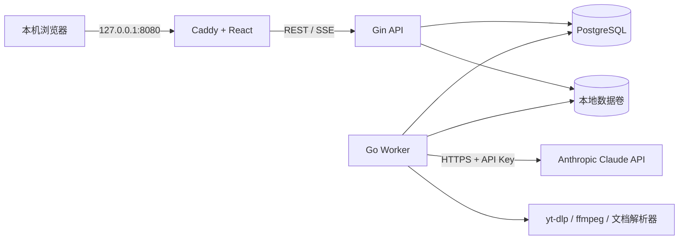

# AI 学习助教 Web 化文档总览

## 1. 文档目的

本目录定义 AI 学习助教从 Python CLI/TUI 转为单用户 Web 应用的产品、前后端、接口、部署和迁移方案。

目标技术栈：

- 前端：React + TypeScript + Vite。
- 后端：Go + Gin。
- 数据库：PostgreSQL。
- 异步任务：PostgreSQL 任务表 + 独立 Go Worker。
- AI：Worker 容器通过 `ANTHROPIC_API_KEY` 调用 Claude Messages API。
- 部署：个人电脑上的 Docker Compose。

> “Claude 在 Docker 中运行”在本文中的准确含义是：Claude API 客户端、提示词编排和结果校验运行在 Worker 容器中；Claude 模型推理由 Anthropic 托管，不是在个人电脑上本地推理。

## 2. 已确认的产品决策

| 决策项 | 结论 |
| --- | --- |
| 用户模式 | 单用户，不设计注册、登录和多租户 |
| 部署环境 | 个人电脑，本机浏览器访问 |
| 对外监听 | 默认仅 `127.0.0.1:8080` |
| 架构形态 | 模块化单体 + 独立 Worker |
| AI 凭证 | Anthropic API Key，通过 Docker secret 只挂载给 Worker |
| 前端设计 | 本文不给出视觉稿；提供产品、状态、交互和验收规范，由前端开发设计 |
| API 风格 | REST + SSE；展开公共响应头后的 `api/openapi.yaml` 是代码生成唯一契约，本文目录保存设计源 |
| 文件存储 | PostgreSQL 保存结构化数据和 Markdown；文件卷保存大文件、临时产物、导出和备份 |
| 消息中间件 | 第一阶段不引入 Redis/RabbitMQ |
| 兼容策略 | 保留旧 Python 工程作为迁移数据源和行为参考，逐步切换 |

## 3. 文档导航

1. [产品需求文档](./01-product-requirements.md)
2. [前端开发交接文档](./02-frontend-handoff.md)
3. [Go 后端与 Worker 架构](./03-backend-architecture.md)
4. [REST 与 SSE 接口文档](./04-api-contract.md)
5. [Docker 部署与运维](./05-deployment-operations.md)
6. [Agent 实施提示词](./06-agent-prompts.md)
7. [旧系统迁移路线](./07-migration-roadmap.md)
8. [OpenAPI 3.1 草案](./openapi.yaml)
9. [前端 Codex 实施提示词](./08-frontend-codex-prompt.md)

## 4. 目标架构



API 与 Worker 使用同一 Go 仓库、相同领域模型和 Repository 接口，只通过不同启动命令运行。API 负责短请求和状态查询；Worker 负责素材解析、Claude 调用、结构化结果校验和后台任务恢复。

## 5. 目标仓库结构

```text
ai-study-tutor/
├── api/
│   └── openapi.yaml                 # 由设计源确定性生成的发布契约，禁止手改
├── apps/
│   └── web/                         # React 前端，由前端开发实现
├── cmd/
│   ├── api/                         # Gin API 入口
│   ├── worker/                      # Worker 入口
│   ├── migrate/                     # 数据库迁移命令
│   └── legacy-import/               # 旧 course/ 数据导入命令
├── internal/
│   ├── course/
│   ├── lesson/
│   ├── material/
│   ├── document/
│   ├── quiz/
│   ├── attempt/
│   ├── mastery/
│   ├── job/
│   ├── ai/
│   ├── filestore/
│   └── platform/
├── db/
│   ├── migrations/
│   ├── queries/
│   └── sqlc.yaml
├── deploy/
│   ├── compose.yaml
│   ├── Caddyfile
│   ├── .env.example
│   └── scripts/
├── docs/web-rebuild/
├── legacy/python/                   # 切换期保留当前 Python 代码
├── Dockerfile.api
├── Dockerfile.worker
├── Dockerfile.tools
└── Makefile
```

第一阶段不要求立即移动现有 Python 文件。实际迁移时可以先在当前仓库旁新增 Go/React 目录，等功能对齐并完成数据导入后再移动旧代码。

## 6. 系统质量目标

- 页面普通读请求 P95 小于 300ms，不包含文件上传和 AI 任务。
- 用户创建 AI 任务后 500ms 内获得任务 ID 和可观察状态。
- 页面刷新、浏览器断线和容器重启后，任务状态可以恢复。
- 考试答案在输入停止后 800ms 内自动保存；切题和提交前强制刷新未保存答案。
- 任意 AI 结构化结果必须通过 Schema 和业务校验后才发布。
- 数据升级前能够完成备份；失败升级能够恢复到上一个镜像和备份。
- 前端不包含或显示 Claude API Key，后端日志不记录 Key 和完整敏感请求体。

## 7. 明确不在第一阶段范围内

- 注册、登录、角色权限和多用户数据隔离。
- 公网部署、域名、HTTPS 和第三方 OAuth。
- Redis、Kafka、RabbitMQ、Kubernetes 和微服务拆分。
- 多设备实时同步、协作编辑和教师班级管理。
- 订阅、计费、配额售卖和模型成本分摊。
- 本地部署 Claude 模型。
- 前端视觉稿和品牌设计；由前端开发基于交接文档完成。

## 8. 官方技术参考

- [Gin 官方文档](https://gin-gonic.com/en/docs/introduction/)
- [Claude Go Messages API](https://platform.claude.com/docs/en/api/go/messages)
- [Claude Structured Outputs](https://platform.claude.com/docs/en/build-with-claude/structured-outputs)
- [Docker Compose secrets](https://docs.docker.com/compose/how-tos/use-secrets/)
- [Docker Compose 启动顺序和健康检查](https://docs.docker.com/compose/how-tos/startup-order/)
- [PostgreSQL `SELECT` 与 `SKIP LOCKED`](https://www.postgresql.org/docs/current/sql-select.html)
